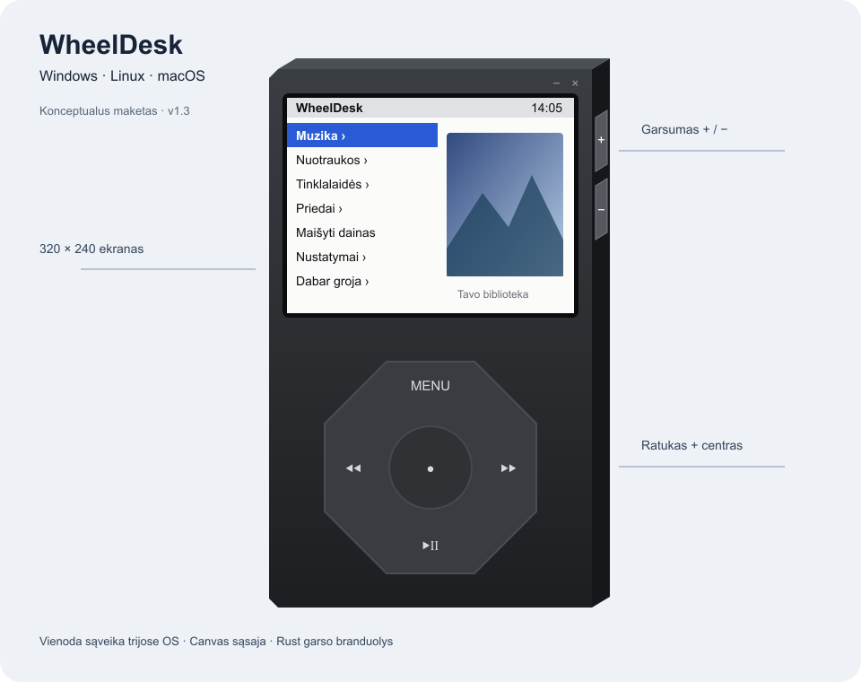

# WheelDesk 1.3.0

[Projekto saugykla](https://github.com/A-Igumenov/WheelDesk).

[English](README_EN.md)

Muzikos grotuvas, sukurtas siekiant kompiuteryje perteikti **„iPod“ primenančią veikimo ir valdymo patirtį**: virtualų ratuką, hierarchinį meniu ir muzikos naršymą nenutraukiant atkūrimo. Skirtas **Windows, Linux ir macOS**. Tarpplatformiškumas – šios pradinės idėjos įgyvendinimo tikslas.

v1.3 skiltyje **Tinklalaidės → šalis → stotis** įdiegtas pasaulio radijo katalogas. Įterptame kataloge **33 936 stotys iš 218 šalių ir teritorijų**, iš jų **50 Lietuvos stočių**. Lietuva rodoma pirmoji, kita / ankstesnė stotis lieka pasirinktoje šalyje.

2026-10-24 Windows ir Linux x64 aplinkose praėjo po **154 TypeScript, 86 Rust testus**; tipų patikra ir sąsajos kūrimas sėkmingi.

Tai pagrindinis vientisas projekto dokumentas: idėja, reikalavimai, architektūra, prototipas, realizavimas, testai, licencijos ir galutinio produkto naudojimas. Automatiniai testai ir rankinis priėmimas aprašomi atskirai.

## Turinys

1. [Produkto idėja ir apimtis](#product)
2. [Reikalavimai ir priėmimo kriterijai](#requirements)
3. [Architektūra, technologijos ir tarpplatformiškumas](#architecture)
4. [Prototipas ir sąveika](#prototype)
5. [Realizavimo principai](#implementation)
6. [Naudotojo vadovas](#manual)
7. [Licencijos, paslaugos ir privatumas](#licensing)
8. [Peržiūros apimtis ir apribojimai](#audit)
9. [Testai ir priėmimo matrica](#testing)
10. [Radijo katalogas](#catalogue)
11. [Priklausomybių licencijų inventorius](#inventory)
12. [Versijų istorija](#history)

<a id="product"></a>
## 1. Produkto idėja ir apimtis

### Problema ir vertė

**Pradinė projekto idėja – sukurti kompiuterinį muzikos grotuvą, savo veikimu primenantį „iPod“ grotuvą.** Pagrindinis atspirties taškas – pažįstamas valdymas ratuku, hierarchinis meniu, pasirinkimas centriniu mygtuku, grįžimas per MENU ir muzikos bibliotekos naršymas nenutraukiant atkūrimo. Ši naudojimo patirtis perkeliama į darbalaukio programą.

Didelę vietinę muzikos kolekciją dažnai norisi valdyti paprastai, neperjungiant daugelio darbalaukio langų. WheelDesk pateikia mažą, savarankišką grotuvą, kuriame biblioteka naršoma virtualiu ratuku, o muzika groja toliau keliaujant per meniu. Internetinis radijas papildo vietinį klausymą: v1.3 pateikiamas 33 936 stočių katalogas iš 218 šalių ir teritorijų, naršomas pasirenkant šalį.

Šią idėją papildo tarpplatformiškumo tikslas – vienoda valdymo patirtis **Windows, Linux ir macOS** kompiuteriuose, dalijantis tuo pačiu sąsajos ir Rust branduolio kodu. Operacinės sistemos integracijos išskiriamos ten, kur skiriasi diskai, langai, garsas ir diegimo paketai.

### Auditorija

- Vietinės muzikos kolekcijos savininkas: atlikėjai, albumai, paieška, grojaraščiai ir klausymo tęstinumas.
- Internetinio radijo klausytojas: stoties pasirinkimas, srauto būsena, perduodami kūrinio duomenys.

### Pagrindiniai naudojimo scenarijai

1. Naudotojas pasirenka diską ir muzikos aplanką, palaukia nuskaitymo, atveria albumą ir paleidžia kūrinį.
2. Klausydamasis sudaro On-The-Go sąrašą, išsaugo jį ir keičia EQ nenutraukdamas garso.
3. Paslepia programą į sistemos dėklą; vėliau grįžta į tą pačią klausymo būseną.
4. Atveria „Tinklalaides“, pasirenka šalį, tada radijo stotį ir mato jos perduodamą dainos pavadinimą, jei toks prieinamas.
5. Atveria vietines nuotraukas, užrašus ar kalendorių; pagalbinės funkcijos lieka viename kompaktiškame įrenginio vaizde.

### Įtraukta į dabartinę realizaciją

Vietinė biblioteka, atkūrimas, internetinis radijas, viršeliai, paieška, importuojami ir vidiniai grojaraščiai, EQ, Sound Check, Crossfade, garsumo riba, nuotraukos, užrašai, ICS, laikrodžiai, žadintuvai, chronometras, ekrano užraktas, du žaidimai ir LT/EN/RU tekstai. Funkcijų įrodymus ir priėmimą aprašo [reikalavimų matrica](#requirements).

### Produkto ribos

Tai darbalaukio programa. Naršyklinis režimas yra sąsajos demonstracija. Nerealizuota debesinė paskyra, prenumeratos katalogas, DRM turinio atrakinimas ar bibliotekos sinchronizavimas tarp kompiuterių. Disko identifikatoriaus išsaugojimas neperkelia grojaraščių kelių tarp skirtingų OS. Užrašai ir kalendoriai skaitomi, bet neredaguojami.

Canvas sąsaja suteikia vientisą vaizdą, tačiau savaime nesukuria semantinių ekrano skaitytuvo valdiklių. Prieinamumo užbaigtumas dar nėra patvirtintas. Žadintuvai priklauso nuo veikiančios programos ir budraus kompiuterio.

### Sėkmės vertinimas

Leidimas vertinamas pagal realų scenarijų: pasirinkti biblioteką, paleisti visas testines formatų imtis, keisti meniu nenutraukiant garso, atkurti būseną po paleidimo iš naujo ir įdiegti paketą kiekvienoje tikslinėje OS. Kol nėra bandymų žurnalo, tai priėmimo tikslai. Našumo ir didelės bibliotekos matavimai turi būti fiksuojami su failų skaičiumi, įranga ir OS, nepateikiant neišmatuotų garantijų.

<a id="requirements"></a>
## 2. Reikalavimai ir priėmimo kriterijai

Žyma „realizuota“ reiškia, kad funkcija yra šaltiniuose. Ji nereiškia sėkmingo galutinio bandymo visose OS. P1 – pagrindinė produkto funkcija; P2 – papildoma funkcija. Toliau pateikta esamos v1.3 realizacijos specifikacija, o ne anksčiau patvirtintas užsakovo reikalavimų dokumentas.

### Funkciniai reikalavimai

| ID / prioritetas | Reikalavimas ir realizacija | Priėmimo kriterijus |
| --- | --- | --- |
| F01 / P1 | Ratukas, klaviatūra, navigacijos istorija; `src/core/wheel.ts`, `navigator.ts`, `src/render/device.ts` | Sukant ir spaudžiant ↑/↓ keičiasi pasirinkimas; Enter atveria, Esc grąžina |
| F02 / P1 | Disko ir santykinio aplanko pasirinkimas; `crates/core/src/volumes.rs` | Pasirinktas šaltinis atkuriamas pakeitus prijungimo vietą, kai yra stabilus ID; dingęs diskas nesukelia griūties |
| F03 / P1 | MP3, M4A/AAC, FLAC, OGG, AIFF indeksavimas ir žymos; `library.rs`, `tests/formats.rs` | Visos penkios testinės imtys randamos ir dekoduojamos; WAV bibliotekoje praleidžiami |
| F04 / P1 | Grojimas, pauzė, eilė, persukimas, Shuffle ir Repeat; `player.rs`, `src/core/playback.ts` | Meniu veikia grojant; kita/ankstesnė daina ir kartojimas atitinka pasirinktą režimą |
| F05 / P1 | Grupavimas, Cover Flow ir paieška; `library.ts`, `search.ts`, `menus.ts` | Randama pagal tekstą su LT/kirilicos simboliais ir diakritikos normalizavimu |
| F06 / P1 | Grojaraščių importas ir On-The-Go; `playlists.rs`, `menus.ts` | Atveriami PLS/XSPF/WPL; ilgas centro paspaudimas prideda įrašą; išsaugotas sąrašas lieka po restartavimo |
| F07 / P1 | Pasaulio radijas pagal šalį; `radio_catalog.rs`, `src/core/radio.ts`, `stream.rs` | 33 936 stotys ir 218 šalių; Lietuva pirmoji, stočių skaičius matomas; next/prev lieka šalyje; testinis srautas groja; klaida / buffering matomi |
| F08 / P2 | Vietiniai ir laisvai licencijuoti pirmojo albumo viršeliai; `art.rs`, `artstore.ts` | Vietinis viršelis rodomas; atviras vaizdas turi autorystę ir licenciją; trūkstamas vaizdas nesustabdo muzikos |
| F09 / P1 | 10 juostų EQ, Sound Check, Crossfade, garsumo riba; `dsp.rs`, `player.rs` | Parametrų keitimas girdimas nenutraukus grojimo; garsumas neviršija programoje nustatytos ribos |
| F10 / P1 | Atkūrimo tęstinumas ir iki 500 istorijos įrašų; `App.tsx`, `menus.ts` | Išsaugota eilė, kūrinys ir pozicija atkuriami; pauzės būsena išlieka; istoriją galima išvalyti |
| F11 / P2 | JPG/PNG/GIF/WebP/BMP peržiūra ir skaidrės; `photos.ts` | Pasirinkto aplanko nuotraukos rodomos tinkleliu bei atskirai, veikia trukmės ir kartojimo nustatymai |
| F12 / P2 | TXT/MD ir ICS skaitymas; `docs.rs`, `src/core/ics.ts` | Atveriamas UTF-8/UTF-16 tekstas; pasikartojantis ICS įvykis ir EXDATE atvaizduojami pagal parserio palaikymą |
| F13 / P2 | Žadintuvai, laikrodžiai, chronometras, ekrano užraktas; atitinkami `src/core` moduliai | Veikiančioje programoje žadintuvas suskamba; chronometras tęsiasi naršant; užraktas išlieka paleidus iš naujo |
| F14 / P2 | Plytos ir muzikos viktorina; `src/core/games` | Žaidimas pradeda raundą; viktorinai naudojama tinkama bibliotekos imtis |
| F15 / P1 | LT/EN/RU, meniu ir išvaizdos nustatymai; `strings.ts`, `menus.ts` | Pakeista kalba ir nustatymai išlieka po paleidimo iš naujo |
| F16 / P1 | Langas, dėklas, visiškas uždarymas; `src-tauri/src/lib.rs`, `bridge.ts` | Minimizavus garsas tęsiasi; dėklo meniu grąžina langą; Close baigia procesą; nesant dėklo taikomas minimizavimas |

### Kokybės ir eksploatavimo reikalavimai

| ID | Reikalavimas | Patikrinimas / būklė |
| --- | --- | --- |
| N01 | Tas pats produkto elgesys Windows, Linux ir macOS | CI turi OS matricą; būtini ir rankiniai garso, dėklo, įvesties bei diegimo bandymai |
| N02 | Sąsaja neturi blokuotis dėl bibliotekos nuskaitymo | Rayon ir Tauri foninės užduotys; pamatuoti didelės bibliotekos scenarijų |
| N03 | Nustatymai atskirti nuo diegimo vietos, sugadintas JSON netrukdo startui | `directories::ProjectDirs`, `Settings::load/save`, numatytosios reikšmės ir laikinas failas prieš rename |
| N04 | Vietinė muzika prieinama be tinklo | Bandymas atjungus tinklą su vietiniu kūriniu; radijui reikalingas tinklas |
| N05 | Dokumentuotas išorinis duomenų naudojimas | Vietiniai viršeliai ir tikslinė atvirų šaltinių užklausa; radijui jungiamasi prie stoties serverio; žr. [licencijas ir privatumą](#licensing) |
| N06 | Testuojamumas | Pagrindinė logika tikrinama automatiniais testais; OS integracijos – atskirais scenarijais |
| N07 | Prieinamumas | Klaviatūros valdymas yra; ekrano skaitytuvo, kontrasto ir skirtingo DPI bandymai dar reikalingi |
| N08 | Saugus platinimas | MIT ir trečiųjų šalių pranešimai pateikti; OS bandymai dokumentuojami pagal faktiškai tikrintą platformą |

Keturių skaitmenų užraktai yra sąsajos funkcijos. Kodai saugomi nustatymuose, todėl tai nėra šifravimas ar OS prieigos kontrolė. Garsumo riba galioja programos valdomam garsumui, ne visam kompiuteriui.

<a id="architecture"></a>
## 3. Architektūra, technologijos ir tarpplatformiškumas

### Komponentų diagrama

```text
+-------------------------- Naudotojas --------------------------+
| Pele / jutikliu: ratukas, centras, MENU, transportas, garsumas  |
| Klaviatura: navigacija, pasirinkimas, pauze, garsumas           |
+-------------------------------+-------------------------------+
                                v
+---------------- React / TypeScript / Canvas ------------------+
| App.tsx: paleidimas, busena, atkurimas, zadintuvu tikrinimas    |
| src/core: Navigator, meniu, biblioteka, Playback, ICS, zaidimai |
| src/render: DeviceView, ekranai, tekstas, vaizdu talpyklos      |
+-------------------------------+-------------------------------+
                                v
+------------------- src/platform/bridge.ts ---------------------+
| Tauri invoke/listen sutartys | Narsykle: demo + localStorage   |
+-------------------------------+-------------------------------+
                                | IPC komandos / ivykiai
                                v
+--------------------- src-tauri/src/lib.rs ---------------------+
| AppState | komandos | fonines uzduotys | langas | sistemos deklas|
+-------------------------------+-------------------------------+
                                v
+----------------------- crates/core ---------------------------+
| volumes + settings | library + playlists | docs + text        |
| art + open_art + radio_catalog + radio + stream               |
| Player gija -> DSP -> rodio / cpal -> OS garsas                |
+-----------+---------------------+--------------------+--------+
            |                     |                    |
            v                     v                    v
  Diskai / JSON / cache      HTTP(S) paslaugos       OS garsas
  Windows / Linux / macOS    ir radijo srautai       ir irenginys
```

Tai loginės priklausomybės, ne atskiri serveriai. React sąsaja veikia sistemos WebView, Rust dalis – vietiniame programos procese, garso atkūrimas – savo gijoje. Kai kurie meniu ir piešimo moduliai tarpusavyje priklausomi: dabartinis `src/core` nėra visiškai nuo atvaizdavimo izoliuotas sluoksnis.

### Technologijų sprendimai

Toliau pateiktas esamų pasirinkimų techninis pagrindimas, o ne istoriniai autoriaus sprendimų protokolai.

| Priemonė | Vaidmuo ir pasirinkimo pagrindas | Kaina / alternatyva |
| --- | --- | --- |
| Tauri 2 | Rust IPC, vietiniai paketai, langas ir dėklas naudojant OS WebView | OS WebView skirtumai ir vietinės kūrimo priklausomybės; Electron turėtų savo naršyklės vykdymo aplinką |
| React 18 + TypeScript | Paleidimas, tipizuotos sutartys ir sąsajos gyvavimo ciklas | Meniu didžiąja dalimi valdomi imperatyviai; tipai nepakeičia IPC vykdymo metu validacijos |
| Canvas 2D + Inter | Viena korpuso geometrija, ratukas, ekranas ir kelių abėcėlių tekstas | Prieinamumas ir hit-testing įgyvendinami atskirai; DOM būtų patogesnis semantiniams valdikliams |
| Rust 2021 | Failų, tinklo, garso ir platformų kodas viename branduolyje | Reikia atskiro toolchain ir kiekvienos platformos bibliotekų |
| rodio / cpal / Symphonia | Atkūrimas, OS garso prieiga, dekodavimas | Tikrinti realius įrenginius, formatų variantus ir transityvines licencijas |
| lofty, walkdir, rayon | Žymos, katalogų traversavimas, lygiagretus indeksavimas | Failų teisių, koduočių ir didelės kolekcijos kraštiniai atvejai |
| serde / serde_json, directories | JSON sutartys ir vietiniai nustatymų katalogai | Failų kelių perkeliamumas ir schemų evoliucija lieka produkto atsakomybe |
| ureq su TLS/JSON | Radijas ir išorinės metaduomenų užklausos | Paslaugų pasiekiamumas, sąlygos, tinklo timeout ir pasikeitę formatai |
| Vite 6, tsc, Vitest 3 | Kūrimo serveris, statinis tikrinimas, UI logikos testai | Naršyklės testai nepakeičia Tauri integracijos bandymų |

Deklaruoti versijų intervalai yra `package.json` ir Cargo manifestuose; konkrečios išspręstos versijos – užrakto failuose. Licencijų būklė aprašyta [atskirai](#licensing).

### Duomenų eiga

1. `App.tsx` per `bridge.ts` užkrauna nustatymus, diskus ir atkūrimo būseną.
2. `LibrarySource` saugo `volumeId` ir santykinį kelią. Rust suranda prijungtą diską, nuskaito talpyklą ir perindeksuoja pasikeitusius failus.
3. UI `Track` objektus grupuoja pagal atlikėją, albumą ir kitus požymius. Pasirinkus kūrinį `Playback` suformuoja eilę.
4. `player_load` / `player_cmd` per IPC perduoda darbą Rust `Player`. Jo gija dekoduoja, taiko DSP ir siunčia garso išvestį; būsena grįžta į UI įvykiais.
5. Vietinis viršelis skaitomas iš garso failo žymų arba gretimo aplanko. Jo neradus, dabar rodomai dainai tikrinami atviri pirmojo albumo metaduomenys ir laisvai licencijuotas Commons viršelis.
6. `resume` nustatymuose saugo kūrinių kelius, indeksą, poziciją ir grojimo būseną arba radijo stoties slug. UI periodiškai ją atnaujina (10 s), taip pat stabdant ir uždarant.

### Saugojimas ir perkeliamumas

Naudojama failinė saugykla; duomenų bazės serverio nėra. `Settings` serializuojamas camelCase JSON, UI papildomi laukai Rust pusėje saugomi per `serde(flatten)`. Bibliotekos indeksas ir viršeliai laikomi talpykloje. Naršyklės demo naudoja `localStorage` ir nėra darbalaukio nustatymų kopija.

| OS | Nustatymų katalogas pagal `ProjectDirs` naudojimą |
| --- | --- |
| Windows | `%APPDATA%\Igumenov\WheelDesk\config` |
| Linux | `$XDG_CONFIG_HOME/wheeldesk`, įprastai `~/.config/wheeldesk` |
| macOS | `~/Library/Application Support/lt.Igumenov.WheelDesk` |

Failas – `settings.json`; talpyklos katalogą atskirai nustato `ProjectDirs::cache_dir()`. Jei katalogų nustatyti nepavyksta, Tauri kodas naudoja darbo katalogą ir jo `cache` poaplankį. Absoliutūs grojaraščių ir kūrinių keliai nėra universali trijų OS duomenų mainų schema.

### Tarpplatformiškumo ribos

| Sritis | Windows | Linux | macOS |
| --- | --- | --- | --- |
| WebView | WebView2 | WebKitGTK 4.1 | Sistemos WebKit |
| Disko ID | Win32 volume identifikacija | `/dev/disk/by-uuid` | `diskutil info -plist` VolumeUUID |
| Atsarginis ID | `mnt:<mount>` kai nepavyksta stabilus ID | Tas pats | Tas pats |
| Dėklas | Tauri tray | Reikia darbalaukio / AppIndicator palaikymo | Tauri tray meniu juostoje |
| Paketai | MSI, NSIS EXE | DEB, RPM, AppImage | APP, DMG; universal arba ARM |

### Prieigos ribos

`src-tauri/capabilities/default.json` leidžia pagrindinio lango operacijas. CSP riboja WebView šaltinius, tačiau asset protokolo leidžiamų kelių sritis yra `**`, o Rust komandos priima vietinius kelius. Tai plati vietinės programos prieiga, ne izoliuota failų saugykla. Prieš viešą leidimą vertinti, ar prieigą galima susiaurinti iki pasirinktų katalogų. Pagrindinės sistemos failų teisės vis tiek galioja.

### v1.3 radijo katalogo plėtra

<a id="prototype"></a>
## 4. Prototipas ir sąveika



[Redaguojamas SVG šaltinis](docs/assets/wheeldesk-prototype.svg). PNG peržiūra sugeneruota iš šio SVG ir vizualiai patikrinta.

Tai dokumentacijai sugeneruotas **vektorinis maketas**, ne veikiančios programos ekrano nuotrauka. Jis remiasi `src/render/theme.ts`: 360 × 600 priekinė plokštuma, 20 × 12 gylio projekcija, bendras 380 × 612 loginio pikselio įrenginio plotas, 320 × 240 ekranas ir aštuonkampis ratukas. Meniu tekstai ir dešinės ekrano dalies iliustracija yra pavyzdiniai.

### Sąveikos projektas

```text
Paleidimas -> nustatymai -> saltinio atkurimas -> meniu
                                |
                          indeksas + skenavimas
                                v
Muzika -> atlikejas / albumas -> daina -> Now Playing
   |                                      |
   +-> paieska / grojarasciai              +-> garsumas / persukimas
   +-> ilgas centras -> On-The-Go

Tinklalaides -> salis -> stotis -> jungimasis -> gyvas srautas
Settings -> biblioteka / kalba / EQ / riba / kiti nustatymai
Extras -> istorija / uzrasai / kalendorius / laikrodziai / zaidimai
```

Reikia atskirti tuščią biblioteką, skenavimą, klaidą, radijo buferiavimą, užrakintą ekraną ir žadintuvo ekraną. Vien pagrindinio meniu vaizdas neaprašo visos sąveikos.

### Vaizdinio priėmimo kriterijai

Visos ratuko ir šoninių mygtukų sritys turi atitikti piešinį; ilgi pavadinimai neturi uždengti valdiklių. Patikrinti 100 %, 150 % ir 200 % ekrano mastelį, lietuviškus bei kirilicos simbolius, aktyvų / neaktyvų langą, pritemdymą ir grįžimą iš dėklo kiekvienoje OS. Canvas padidina fizinę skiriamąją gebą pagal `devicePixelRatio`, tačiau vien to nepakanka patvirtinti visus DPI ir WebView skirtumus.

### v1.3 radijo ekranai

<a id="implementation"></a>
## 5. Realizavimo principai

1. Apibrėžti produkto idėją, reikalavimus ir vienodą elgesį Windows, Linux ir macOS sistemose.
2. Realizuoti korpusą, ratuko valdymą, navigaciją ir demonstracinį režimą.
3. Apibrėžti TypeScript ir Rust duomenų sutartis bei komandų ir įvykių sąveiką.
4. Įgyvendinti nustatymų saugojimą, diskų atpažinimą, bibliotekos indeksą ir metaduomenų skaitymą.
5. Įgyvendinti atkūrimo eilę, garso dekodavimą, transporto komandas, būsenas ir klaidų valdymą.
6. Pridėti paiešką, grojaraščius, viršelius ir radijo stočių pasirinkimą pagal šalį.
7. Integruoti EQ, garsumo suvienodinimą, perėjimus, nuotraukas ir priedus.
8. Tikrinti funkcijas automatiniais testais ir realiais naudojimo scenarijais visose tikslinėse sistemose.

Sąsajos ir garso branduolio kodas bendras, o OS skirtumai izoliuojami diskų, failų, lango, sistemos dėklo ir garso prieigos sluoksniuose. Pakeitimai siejami su reikalavimų identifikatoriais bei testų rezultatais.

<a id="manual"></a>
## 6. Naudotojo vadovas

Šis vadovas skirtas v1.3. Meniu keliai pateikti angliškai, kad juos būtų lengva sulyginti su numatytąja sąsaja. Kalbą galima pakeisti nustatymuose į lietuvių, anglų arba rusų.

### Diegimas ir pirmasis paleidimas

Pasirinkite savo OS ir procesoriui skirtą, patikimo projekto platintojo pateiktą paketą. Windows paleiskite MSI arba setup EXE vedlį. Linux DEB/RPM įdiekite savo distribucijos paketų tvarkytuve arba suteikite AppImage vykdymo teisę ir paleiskite jį. macOS atverkite DMG ir perkelkite WheelDesk.app į Applications; Apple Silicon rinkitės ARM arba universal variantą.

Jei macOS neleidžia atverti nepasirašytos ar nenotarizuotos programos, patikrinkite jos kilmę ir naudokite sistemos siūlomą leidimą konkrečiai programai per Privacy & Security. Saugos patikrų išjungti visai sistemai nereikia. Windows reikalingas WebView2, Linux – suderinamas WebKitGTK ir garso aplinka. Patikrinimų rezultatai pateikti [testų skyriuje](#testing).

Paleiskite programą, atverkite **Settings → Library Source**, pasirinkite diską ir muzikos aplanką. Palaukite nuskaitymo, tada atverkite **Music → Albums** arba **Songs** ir pasirinkite kūrinį. Tuščia biblioteka gali reikšti netinkamą aplanką, nepalaikomą formatą arba neprieinamą diską.

### Valdymas

| Veiksmas | Valdymas |
| --- | --- |
| Pasirinkti eilutę | Sukti virtualų ratuką, pelės ratuką, naudoti jutiklinį kilimėlį arba ↑ / ↓ |
| Atverti pasirinkimą | Centrinis mygtukas arba Enter |
| Grįžti | MENU, Esc arba Backspace |
| Groti / pauzė | Apatinė ratuko sritis arba Space; centro vidurys veikia kaip transporto valdiklis |
| Ankstesnė / kita | Kairė / dešinė ratuko sritis arba ← / → |
| Persukti | Laikyti ankstesnės / kitos dainos mygtuką; Now Playing centre pereiti į eigos režimą |
| Garsumas | Šoniniai + / −, klaviatūros + / −; Now Playing ratukas |
| On-The-Go | Laikyti centrą ant muzikos įrašo; klaviatūra – laikyti Enter |
| Perkelti langą | Tempti korpusą ar ekraną |
| Paslėpti / išeiti | Korpuso minimize / close mygtukai |

Centro pakraščiai taip pat veikia kaip vairalazdė navigacijai. **Settings → Mouse Control** įjungia tiesioginį meniu eilučių spaudimą pele; numatytai jis išjungtas. Paieškos teksto ekrane galima rašyti klaviatūra.

### Muzika ir grojaraščiai

Biblioteka naršoma pagal atlikėjus, albumus, dainas, žanrus, kompozitorius, rinkinius ir audioknygas. Paieška nepaiso raidžių dydžio ir diakritikos; žodžių pradžios paieška leidžia įvesti kelis trumpinius. Palaikomi MP3, M4A/AAC, FLAC, OGG ir AIFF; WAV skenavimas praleidžia. Failo plėtinys negarantuoja, kad kiekvienas jo kodeko variantas bus dekoduojamas.

**Now Playing** rodo kūrinį, trukmę ir eilę. Ankstesnės dainos komanda po daugiau kaip trijų sekundžių pirmiausia grąžina į kūrinio pradžią. Viršelį galima išdidinti dukart spustelėjus. Shuffle ir Repeat nustatomi nustatymuose. Uždaroma programa išsaugo eilę, vietą ir grojimo / pauzės būseną; atkurti gali tik vis dar prieinamus failus. Staiga nutrūkus procesui gali likti paskutinė periodiškai išsaugota pozicija.

**Extras → History** rodo iki 500 pradėtų groti įrašų ir radijo dainų; įrašą galima paleisti dar kartą arba išvalyti istoriją.

Pasirinkus muzikos šaltinį, ekrano pelės pasirinkimas ir grįžimas veikia ir bibliotekos nuskaitymo metu, kai įjungtas **Valdymas pele**. Rankinio EQ mažojo ratuko viršus ir klaviatūros ↑ didina juostos reikšmę; apačia ir ↓ mažina. Sukamojo rato kryptis išlieka įprasta.

### Radijas ir viršeliai

Atverkite **Tinklalaidės → šalis → stotis** ir palaukite prisijungimo. Kataloge 33 936 stotys iš 218 šalių ir teritorijų; Lietuva pirmoji (50 stočių). Katalogui naršyti interneto nereikia, srautui ir internetiniams vaizdams reikia. Kita / ankstesnė stotis lieka pasirinktoje šalyje. Jei stotis perduoda kūrinio informaciją, ji rodoma ekrane. Pauzė gyvam srautui nereiškia vėlesnio klausymo nuo tos pačios sekundės – tęsiant jungiamasi prie tiesioginio srauto.

Viršeliai pirmiausia skaitomi iš muzikos failo arba gretimo aplanko. Jei vietinio vaizdo nėra, dabar grojamai dainai ieškomas ankstyviausias MusicBrainz duomenyse rastas oficialus albumas. Pagal jo Wikidata ryšį tikrinamas Wikimedia Commons vaizdas. Rinkiniai, Live ir Remix albumai atmetami; vienodas kitos grupės dainos pavadinimas netinka.

Naudojami tik CC0, public domain, CC BY arba CC BY-SA vaizdai su patikrintomis sąlygomis. Neaiški licencija, papildomi ribojimai ar trūkstama reikalaujama autorystė reiškia, kad vaizdas nerodomas. Tai nėra garantija, kad bus rastas kiekvienos dainos viršelis ar visa istorinė diskografija. Interneto, metaduomenų ar tinkamo vaizdo nebuvimas nesustabdo muzikos.

Po viršeliu rodoma **Wikimedia Commons · licencija · i** eilutė. Klavišas **i** arba šios eilutės paspaudimas atveria albumo pavadinimą, datą, autorių, šaltinio ir licencijos nuorodas. Šie pranešimai pasiekiami ir **Settings → Legal**. Rodomas vaizdas gali būti pritaikytas ekrano dydžiui; originalus failas nekeičiamas. Naršant biblioteką masinė viršelių paieška nevykdoma; užklausų eilė ir lygiagretumas riboti, rezultatai kaupiami vieną dieną.

### Garsas

Nustatymuose pasirinkite **EQ** režimą arba Custom: dešimt juostų nuo 32 Hz iki 16 kHz, ±12 dB. **Sound Check** naudoja ReplayGain arba išmatuotą garsumą. **Audio Crossfade** sujungia kūrinių pabaigą ir pradžią; trumpiems kūriniams bei Repeat One taikomos išimtys. **Volume Limit** riboja programos garsumą, pasirinktinai apsaugomas keturių skaitmenų kodu; nustatymų atkūrimas ribos nepanaikina.

Ekrano užraktas ir garsumo kodas nėra failų šifravimas. Kompiuterio nustatymų prieigą turintis asmuo gali pasiekti nustatymų failą.

### Nuotraukos ir priedai

- **Photos:** pasirinkite nuotraukų aplanką, naršykite albumus ir 4 × 3 tinklelį, atverkite visą vaizdą. Skaidrių nustatymuose keiskite 2–20 s trukmę, kartojimą, maišymą ir perėjimus. JPG, PNG, GIF, WebP, BMP rodymas priklauso ir nuo WebView dekoderio; animuotas GIF atskirai negarantuojamas.
- **Extras → Notes:** pasirinkite TXT/MD aplanką ir skaitykite tekstą. Tai nėra Markdown redaktorius. Vieno failo skaitymas ribojamas iki 512 KiB, tad ilgas tekstas gali būti nukirstas.
- **Extras → Calendars:** pridėkite ICS failus ir peržiūrėkite bendrą kalendorių. Palaikomi dalis pasikartojimų ir EXDATE; visos ICS standarto galimybės negarantuojamos.
- **Alarms:** nustatykite laiką, kartojimą ir signalą / grojaraštį; atidėjimas – devynios minutės. Programa turi veikti, kompiuteris negali būti išjungtas ar miegoti.
- **Clocks / Date & Time:** pasirinkite miestus, 12/24 valandų formatą ir laiką antraštėje. Datos bei laiko zona remiasi OS duomenimis.
- **Stopwatch:** paleiskite / stabdykite transporto mygtuku, centru žymėkite ratą, sustabdę atkurkite nulį ir sesijos žurnalą.
- **Screen Lock:** nustatykite ir įveskite keturių skaitmenų kombinaciją. Užrakinimo būsena išsaugoma.
- **Games:** pasirinkite Plytas arba Muzikos viktoriną; viktorinai reikia pakankamai ilgų, skirtingų pavadinimų bibliotekos kūrinių.

### Fonas, atsarginės kopijos ir šalinimas

Minimize mėgina paslėpti langą dėkle; muzika ir žadintuvai veikia toliau. Dėklo meniu leidžia grąžinti langą, valdyti grojimą arba išeiti. Jei Linux aplinka nepalaiko dėklo, taikomas įprastas minimizavimas. Close visiškai uždaro programą.

Prieš kopijuodami nustatymus uždarykite programą. Išsaugokite `settings.json` iš [OS nustatymų katalogo](#architecture), originalius muzikos failus ir išorinius grojaraščius. Talpyklą galima atkurti iš naujo nuskaitant biblioteką; ji nepakeičia muzikos atsarginės kopijos. Atkuriant kitame kompiuteryje ar OS gali tekti iš naujo pasirinkti biblioteką ir grojaraščių kelius. Asmeniniame JSON gali būti failų kelių, istorijos ir kodų – neviešinkite jo be peržiūros.

Windows šalinkite per Installed Apps, Linux – paketų tvarkytuve arba pašalindami AppImage, macOS – pašalindami programą iš Applications. Nustatymų ir talpyklos pašalinimas yra atskiras veiksmas; prieš jį pasirūpinkite kopija.

### Trikčių šalinimas

| Simptomas | Veiksmas |
| --- | --- |
| Neranda muzikos | Patikrinti diską, aplanko teises, formatą; dar kartą pasirinkti Library Source |
| Pasikeitus prijungimui neatsikuria šaltinis | Prijungti diską; jei naudotas `mnt:` atsarginis ID, pasirinkti jį iš naujo |
| Nėra garso | Patikrinti programos ir OS garsumą, limitą, išvesties įrenginį; išbandyti kitą žinomai tinkamą failą |
| Radijas neprisijungia | Patikrinti internetą ir kitą stotį; galimas pasikeitęs adresas ar paslaugos sutrikimas |
| Nėra viršelio | Patikrinti vietinį vaizdą; atviruose šaltiniuose gali nebūti licencijuoto ar tiksliai susieto viršelio |
| Prarasti nustatymai | Patikrinti rašymo teises ir JSON kopiją; sugadintas / trūkstamas failas užkrauna numatytąsias reikšmes |
| Žadintuvas nesuskambėjo | Patikrinti, ar programa veikė ir kompiuteris nemiegojo, OS laiką ir kartojimo dieną |
| Linux nėra dėklo | Patikrinti darbalaukio AppIndicator palaikymą ir bibliotekas |

Pranešdami klaidą pridėkite programos versiją, OS/architektūrą, veiksmus, tikėtiną ir faktinį rezultatą bei nuasmenintą klaidos tekstą.

<a id="licensing"></a>
## 7. Licencijos, paslaugos ir privatumas

### Projekto licencija

WheelDesk kodui ir originaliems projekto ištekliams taikoma **MIT** licencija. Visas tekstas – [LICENSE](LICENSE). Ji leidžia naudoti, mokytis, keisti ir platinti programą, išsaugant licenciją bei autorystės pranešimą. Edukacinė paskirtis nėra papildomas naudojimo apribojimas. Cargo ir npm metaduomenys suderinti su MIT.

### Priklausomybės ir privalomi pranešimai

Patikrintos **674 konkrečių versijų priklausomybės: 505 Cargo ir 169 npm**. Patikra apima tiesioginius, netiesioginius, kūrimo ir pasirinktinius platformų paketus, įskaitant Windows, Linux ir macOS ARM. Kiekvienam įrašui išsaugota oficiali deklaracija, licencijos tekstas, įrodymo nuoroda, kontrolinė suma ir taikytinos pareigos. Trūkstamų manifestų ar nenustatytų licencijų įrašų neliko.

[Licencijų registras](licenses/inventory.json), [privalomi pranešimai](licenses/OBLIGATIONS.txt) ir visas `licenses` katalogas yra dokumentacijos dalis. Kai paketas nepateikia atskiro teksto, registre aiškiai nurodytas oficialus bendras tekstas bei konkretaus paketo deklaracija; platformos variantams išsaugotos to paties projekto sąlygos. Tai nėra visų komponentų perlicencijavimas į MIT.

- MIT, BSD, ISC, Apache, Unicode ir kitų leidžiančių licencijų tekstai bei esami autorystės / NOTICE pranešimai išsaugoti.
- Inter šriftas nepakeistas; jo autorystė ir OFL-1.1 pateiktos kartu. Šriftas atskirai neparduodamas.
- MPL-2.0 komponentų nepakeisti tikslių versijų šaltiniai pateikti `licenses/sources`; atitinkami keliai įrašyti registre. Šiems failams toliau taikoma MPL.
- CC-BY-4.0 ir CDLA duomenų sąlygos bei autorystė išsaugotos. Alternatyvios licencijos neprilyginamos vienalaikiam visų alternatyvų taikymui; AND sąlygos vykdomos kartu.
- Programos ikona turi originalų atkuriamą piešinį; prototipas ir sintetiniai testiniai garso signalai yra projekto ištekliai. [Išteklių aprašas](licenses/ASSETS.txt).
- Linux AppImage 200 failų iš 117 sisteminių paketų licencijos ir paleidiklio sąlygos pateiktos `licenses/linux-runtime`. 59 paketų atitinkami šaltiniai ir paleidiklio LGPL komponento šaltiniai yra `corresponding-source`; juos būtina pateikti kartu su pranešimais. Atskirai OS teikiamoms bibliotekoms galioja jų tiekėjų sąlygos.

Windows WebView2 SDK 1.0.3800.47 loaderio BSD-3-Clause tekstas ir Microsoft pranešimai išsaugoti [atskirai](licenses/windows-webview2/LICENSE.txt); jie nepakeičiami Rust apvalkalo MIT licencija. Evergreen vykdymo aplinka įdiegiama atskirai pagal Microsoft sąlygas. macOS sistemos WebKit ir OS karkasai neplatinami kaip projekto šaltiniai.

Rust standartinės bibliotekos ir jos komponentų pranešimai išsaugoti `licenses/rust-standard-library`: Windows Rust 1.99.1, Linux Rust 1.93.1. Jie papildo užrakintų priklausomybių registrą, nes standartinė biblioteka į Cargo.lock nepatenka.

### Radijo duomenys ir išorinės teisės

Radijo katalogo metaduomenys yra Radio Browser katalogo atranka iš [radio-playlists](https://github.com/AlonDrilich/radio-playlists). Duomenims taikoma [CC0-1.0](licenses/radio-catalogue-CC0.txt); [patikros įrodymai](licenses/catalogue-evidence.json). Tai nesuteikia teisių į stočių garsą ar prekių ženklus. Stotys klausomos tiesiogiai iš jų serverių; jų įrašai ir logotipai neplatinami su programa. Komercinių vaizdų katalogų integracijų nėra. Leidžiama tik atvirų šaltinių paieška su kiekvieno vaizdo licencijos patikra; žr. [sąlygas](licenses/OPEN_ARTWORK.txt). Naudotojo muzikai ir vaizdams lieka galioti turimos naudojimo teisės.

WheelDesk yra savarankiškas projektas. iPod sąveikos idėja nereiškia Apple patvirtinimo ar partnerystės.

### Privatumas

Biblioteka, nustatymai ir istorija saugomi kompiuteryje. Vietiniai viršeliai skaitomi iš muzikos failo ar aplanko. Jų neradus, dabar rodomos dainos atlikėjas ir pavadinimas siunčiami MusicBrainz; albumo identifikatorius – Wikidata, o vaizdo vardas ir užklausa – Wikimedia Commons. Šiems serveriams matomi įprasti ryšio duomenys. Reitingai, naudotojų tekstai ar kiti papildomai ribojami MusicBrainz duomenys nenaudojami. Katalogas užkraunamas vietoje. Pasirinkus internetinę stotį, jungiamasi prie jos srauto ir galimų peradresavimo serverių; jiems matomi įprasti ryšio duomenys, įskaitant IP adresą. Ankstesnė stotis gali būti atkurta pagal išsaugotą atkūrimo būseną. Nustatymų failas nėra šifruotas.

<a id="audit"></a>
## 8. Peržiūros apimtis ir apribojimai

### Aprėptis ir metodas

Peržiūros data: 2026-10-24. Pradinė Graphify inventorizacija aptiko 97 palaikomus analizuoti failus, apie 70 tūkst. žodžių; į sąrašą įeina kodas, dokumentai, konfigūracijos ir vaizdai. Tai nėra visų diske esančių failų skaičius. Dvejetainiai medijos / ikonų failai vertinti pagal paskirtį ir nuorodas, ne kaip perskaitytas programinis kodas.

Peržiūrėti sąsajos, garso branduolio, platformos sąveikos, konfigūracijų ir testų šaltiniai. Tai funkcijų ir dokumentacijos peržiūra, ne pilnas saugumo auditas.

### Rasti ir dokumentuoti neatitikimai

| Klausimas | Faktas / veiksmas |
| --- | --- |
| Licencija | MIT taikoma projekto kodui; visų 674 priklausomybių sąlygos ir pranešimai pateikti atskirai |
| Produkto dokumentacija | Ankstesni README daugiausia pristatė funkcijas ir versijas; pridėta nuosekli aukšto lygio specifikacija ir naudotojo vadovas |
| Privatumo pažadai | Kode yra internetinės metaduomenų užklausos ir radijo užkrovimas paleidžiant; dokumentacijoje nebekartojamas absoliutus pažadas apie jokį duomenų siuntimą |
| Tarpplatformiškumas | Aprašyti konkretūs ID, WebView, dėklo, paketų ir architektūrų skirtumai; stabilaus ID fallback priklauso nuo prijungimo vietos |
| Testų spragos | Pridėti asinchroninio atkūrimo, resume, ribų, laiko ir saugojimo regresijos testai bei rankinių scenarijų matrica |
| Realus vizualas | Pridėtas pagal geometriją sugeneruotas SVG maketas; jis nevadinamas ekrano nuotrauka |

### Kas dar nėra patvirtinta

macOS ARM, Intel/universal ir Windows ARM64 realių paketų bandymai; visi rankiniai funkcijų scenarijai kiekvienoje OS; ekrano skaitytuvai; didelės bibliotekos matavimai; kiekvienos radijo stoties dabartinis pasiekiamumas. Žadintuvai miego ar išjungimo metu ir duomenų sinchronizavimas tarp OS nepriskiriami įgyvendintoms garantijoms.

v1.3 pataisyta pelės navigacija nuskaitymo metu ir rankinio EQ kryptis. Pridėta atvirų šaltinių pirmojo albumo viršelių paieška, tikrinanti kiekvieno vaizdo licenciją. Licencijų deklaracijų, tekstų, autorystės bei atitinkamų šaltinių rinkinys užbaigtas dokumentuota apimtimi. 2026-10-24 automatinių patikrinimų rezultatai registruojami [testavimo dokumente](#testing).

Pradinėje peržiūroje patikrintos 16 produkto Markdown failų vietinės nuorodos ir uždaryti kodo blokai; neveikiančių nuorodų nerasta. SVG XML struktūra validi, sugeneruota PNG peržiūra vizualiai patikrinta. Visų 674 užrakintų priklausomybių licencijų deklaracijos, tekstai ir įrodymai surinkti.

### v1.3 pakeitimų patikra

Naršyklės v1.3 demonstracijoje vizualiai patikrintas radijo šalių ekranas (Lietuva pirmoji, 50 stočių) ir Lietuvos stočių sąrašas su žanrais. Tai nepakeičia tikro garso atkūrimo ir visų OS priėmimo patikrų. Visų 18 dabartinių Markdown dokumentų vietinės nuorodos patikrintos.

<a id="testing"></a>
## 9. Testai ir priėmimo matrica

Rinkinį sudaro automatizuoti logikos, failų ir dekodavimo bandymai bei rankinis galutinio produkto priėmimas. Toliau išvardyti visi F01–F16 reikalavimai; tai scenarijų aprėptis, ne teiginys apie 100 % kodo eilučių ar visų įmanomų įvesčių aprėptį. Naršyklės demo ir IPC pakaitalai nepatikrina tikro Tauri lango ar garso.

### Automatinės aprėpties žemėlapis

Keliai šioje lentelėje santykiniai projekto šakniai. Rust modulių unit testai yra atitinkamame `crates/core/src` faile.

| Reikalavimai | Automatiniai įrodymai | Kas lieka rankiniam bandymui |
| --- | --- | --- |
| F01 ratukas / navigacija | `src/core/wheel.test.ts`, `navigator.test.ts` | Pelė, touchpad, centro laikymas, DPI ir paspaudimų sritys |
| F02 disko šaltinis | `volumes.rs` testai, navigator Library Source | USB atjungimas ir prijungimas kiekvienoje OS |
| F03 failai / žymos | `library.rs`, `text.rs`, `crates/core/tests/formats.rs`, `regression.rs` | Didelė reali biblioteka ir formatų variantai |
| F04 transportas / eilė | `player.rs`, `src/core/playback.test.ts`, navigator / library testai | Girdimas garsas, įrenginio pakeitimas ir ilgas atkūrimas |
| F05 paieška / grupavimas | `library.test.ts`, `regression.test.ts`, navigator | Cover Flow išvaizda, ilgi tekstai ir greitas naršymas |
| F06 grojaraščiai | `playlists.rs`, Rust `regression.rs`, navigator On-The-Go | Realūs importuoti keliai, išsaugojimas ir restartas |
| F07 radijas | `radio_catalog.rs`, `radio.rs`, `stream.rs`, `radio.test.ts`, `playback.test.ts`, šalių meniu testai | Tikras MP3/AAC/OGG/HLS srautas, prisijungimo nutrūkimas |
| F08 viršeliai | `art.rs`, `formats.rs`, navigator artwork | Vaizdo kokybė, tinklo klaida, cache po restarto |
| F09 DSP / riba | `dsp.rs`, `player.rs`, `formats.rs`, `regression.test.ts`, `playback.test.ts` | Girdimi EQ, Sound Check, perėjimas ir realus ribojimas |
| F10 resume / istorija | `playback.test.ts`, `bridge.test.ts`, Rust `regression.rs`, navigator History | Visas App startas / uždarymas, periodinis išsaugojimas, 500 įrašų riba |
| F11 nuotraukos | navigator Photos, Rust failų atradimo regresija | WebView dekodavimas, slideshow trukmė / shuffle / fade ir atmintis |
| F12 Notes / ICS | `docs.rs`, Rust `regression.rs`, `ics.test.ts`, navigator | Koduotės, dideli dokumentai ir realūs ICS failai |
| F13 laikas / kodai | `regression.test.ts`, `library.test.ts`, navigator alarm / lock / clocks / stopwatch | Suskambėjimas fone, snooze, lango parodymas ir kodų ekranai |
| F14 žaidimai | `src/core/games/games.test.ts`, navigator Games | Piešimas, įvestis, peržiūros garsas ir išėjimas |
| F15 kalbos / nustatymai | navigator LT/RU / settings, `bridge.test.ts`, `settings.rs` | Visi tekstai trijose kalbose, išlikimas tikrame pakete |
| F16 langas / dėklas | Automatinių OS integracijos E2E testų dar nėra | Minimize, tray transportas, parodymas, Close ir žadintuvas |

### Nauji regresijos bandymai

- `src/core/playback.test.ts`: 21 bandymas – tuščios eilės, pauzė, transportas, peržiūra, resume, garsumo kvantavimas ir riba, radijo užklausų eiliškumas, klaidos, gyvo srauto persukimo draudimas, metaduomenys. IPC kvietimai pakeisti stebimais pakaitalais; Rust jų vykdymas tikrinamas atskirai.
- `src/core/regression.test.ts`: 39 bandymai – žadintuvų dienos, pakartotinio skambėjimo prevencija, vidurnaktis, EQ reikšmių ribos ir presetų apsauga, 12/24 h, Vilniaus DST, dalinės valandos zona, chronometro pauzė ir paieškos ribos.
- `src/platform/bridge.test.ts`: 5 bandymai – browser demo nustatymų round-trip, resume/kodai/EQ, senesnės konfigūracijos, sugadintas arba neprieinamas localStorage ir dingęs šaltinis.
- `crates/core/tests/regression.rs`: 6 bandymai – UI laukų išlikimas per Rust nustatymus, klaidos rašant, tekstų dydžio riba, nuotraukų atradimas, išoriškai pakeistas Unicode grojaraštis ir pašalintų/pridėtų failų indeksas.

### Rankinis priėmimo rinkinys

Pasiruošimas: penkių garso formatų imtys, bent du albumai / atlikėjai, LT/RU pavadinimai, sugadintas failas, USB diskas, penkių formatų grojaraščiai, nuotraukų poaplankiai, TXT/MD/ICS ir prieinamas radijas. Naudoti tik turinį, kurį leidžiama naudoti testams; kritinių duomenų nenaudoti. Kiekvieną T atvejį vykdyti Windows, Linux ir macOS ARM; Intel/universal bei Windows ARM64 – jei platinami tokie paketai.

| ID / reikalavimas | Veiksmai | Tikėtinas rezultatas |
| --- | --- | --- |
| T01 / N01,N08 | Švariai įdiegti OS/CPU paketą, paleisti, uždaryti, paleisti dar kartą | Atsidaro be kūrimo įrankių; nėra fatal klaidos; užfiksuota programos versija |
| T02 / F01 | Sukti į abi puses pele, slinkti touchpad, ↑/↓, Enter, Esc, laikyti centrą | Navigacija atitinka valdymo lentelę; nėra dvigubo veiksmo / užstrigimo |
| T03 / F02 | Pasirinkti USB aplanką, restartas, atjungti ir prijungti kita raide/vieta | Su stabiliu ID šaltinis randamas; dingęs diskas nesugriauna; `mnt:` atvejis užrašomas atskirai |
| T04 / F03 | Skenuoti penkis formatus, sugadintą failą ir WAV; pridėti / pašalinti dainą, perskenuoti | Tinkami failai matomi ir groja, WAV praleistas, indeksas atnaujintas |
| T05 / F04 | Groti, pauzė, next/prev po 1 s ir >3 s, laikyti persukimą, naršyti grojant | Laikas / garsas atitinka komandą, po >3 s prev grąžina pradžią; meniu nesustabdo garso |
| T06 / F04 | Shuffle songs/albums ir Repeat off/one/all eilės pabaigoje | Neprarasti įrašai, albumų grupė išlaikyta; pabaigos elgesys atitinka režimą |
| T07 / F05 | Atlikėjai, albumai, compilations, žanrai, kompozitoriai, audioknygos, Cover Flow; LT/RU paieška | Teisingos grupės / tvarka, tuščio rezultato būsena, diakritikos atitikmenys |
| T08 / F06 | Laikant centrą pridėti dainą / albumą / atlikėją; save On-The-Go; clear atšaukti ir patvirtinti | Teisinga eilė; atšaukus lieka duomenys; save lieka po restarto |
| T09 / F06 | Importuoti PLS/XSPF/WPL, išoriškai pakeisti failą, sugadinti vieną kelią | Pakeitimai matomi atvėrus, išlikusi tvarka, trūkstamas kūrinys nesugriauna programos |
| T10 / F07 | MP3/AAC/OGG/HLS radijas; next/prev, greitai perjungti besijungiančias stotis | Groja paskutinė pasirinkta; rodoma klaida / buffering, metaduomenys, jei yra |
| T11 / F07,N04 | Radijui nutraukti / atkurti tinklą, paleisti vietinę dainą be tinklo | Srautas atsikuria arba pateikia klaidą; vietinė muzika groja |
| T12 / F08 | Vietinis viršelis, pirmasis albumas, kita to paties pavadinimo daina, laisva / neaiški licencija, i pranešimai, offline | Tinkamas arba tuščias vaizdas, išdidinimas grįžtamas, garsas nenutrūksta |
| T13 / F09 | EQ Off/preset/Custom min/max grojant failui ir radijui | Pokytis girdimas, garsas nesugriūva, nustatymai išlieka |
| T14 / F09 | Sound Check su ReplayGain / be jo; Crossfade ilgiems, trumpiems kūriniams, Repeat One | Tikrinti suvienodinimą ir perėjimą; trumpiems / Repeat One nėra netinkamo dvigubo atkūrimo |
| T15 / F09,F13 | Garsumo riba / kodas, viršyti visais valdikliais; restartas ir Reset Settings | Programos garsumas ribojamas, kodas saugo keitimą, riba lieka po reset |
| T16 / F10 | Uždaryti / atverti kūrinį viduryje grojant ir sustabdžius; radijas; dingęs išsaugotas failas | Eilė / pozicija / būsena arba stotis atkuriama; dingęs failas suvaldomas |
| T17 / F10 | Keli kūriniai ir radijo dainos, History replay / clear; 501+ įrašų imtis | Naujausi viršuje su laiku, daugiausia 500; clear išlieka |
| T18 / F11 | JPG/PNG/GIF/WebP/BMP, poaplankiai, 12+ vaizdų, viso ekrano rodymas, sugedęs failas | Tinkama atranka ir navigacija; klaida nesugriauna programos |
| T19 / F11 | Slideshow 2/20 s, repeat/shuffle/fade deriniai; išeiti | Laikas ir parinktys veikia, išėjus nelieka skaidrių laikmačio |
| T20 / F12 | TXT/MD UTF-8/UTF-16/CP1251/CP1257, >512 KiB, trūkstamas failas | Įskaitomas tekstas, valdoma dydžio riba / klaida; failas nepakeistas |
| T21 / F12 | Keli ICS, pasikartojimai, EXDATE, visos dienos, mėnesio/metų riba | Palaikomi įvykiai tinkamomis datomis; nepalaikomas atvejis užregistruotas |
| T22 / F13 | Alarm once/daily/weekdays/weekends, beep/playlist, minimize, snooze/dismiss | Budrioje sistemoje vienas skambėjimas, 9 min snooze, langas parodytas |
| T23 / F13 | 12/24 h, laikas antraštėje, miestai; stopwatch su ratais, pauze, kitais meniu | Teisingas laikas, chronometras tęsiasi meniu, pauzė neįskaičiuota, logas išsaugotas |
| T24 / F13 | Lock, neteisingas / teisingas kodas; restartas užrakinus | Klaidingas neatveria meniu, restartas išlaiko užraktą, teisingas atrakina |
| T25 / F14 | Plytos start/pause/lose; quiz su pakankama / maža biblioteka; išeiti | Tinkama įvestis, rezultatai, maža imtis suvaldoma; išeinant nelieka nepageidaujamo garso |
| T26 / F15,N07 | LT/EN/RU, Main/Music Menu, Mouse Control, clicker, backlight; DPI 100/150/200 % | Parinktys išlieka, Settings pasiekiamas, įskaitomi tekstai, atitinka paspaudimų sritys |
| T27 / F16 | Minimize, tray Show/play/next/quit; dar kartą paleisti, Close | Garsas lieka minimizavus; quit/Close užbaigia procesą |
| T28 / F16,N01 | Linux be tray, macOS meniu juosta, Windows dėklas | Tinkamas platformos elgesys ir Linux minimizavimo fallback |
| T29 / N03 | Settings kopija, sugadintas JSON testiniame profilyje, atkurti kopiją; neprieinamas katalogas | Startuoja su defaults, dokumentuota rašymo klaida / jos pateikimo spraga; kopija atkuriama |
| T30 / N02 | Didelė biblioteka, matuoti cold/warm startą, scan, RAM, navigaciją grojant | Užrašyti dydžiai / laikai; sąsaja valdoma, matomas progresas; našumo išvada pagrįsta matavimu |
| T31 / N05 | Stebėti tinklą startuojant, rodant vietinį viršelį, grojant failą / radiją | Domenai / siunčiami laukai atitinka privatumo aprašą |
| T32 / N08 | Atnaujinti ankstesnę versiją, tikrinti settings, pašalinti | Nustatymai išlieka pagal atnaujinimo tikslą; OS pašalinimas tinkamas; licencijos pridėtos |

### Rezultatų žurnalas

Kiekvienam atvejui pildyti: `T-ID | app versija / commit arba šaltinių kopijos ID | OS versija / CPU | vykdytojas / data | PASS/FAIL/BLOCKED/NOT RUN | faktinis rezultatas / įrodymas / klaidos ID`. Nevykdytas atvejis nėra PASS. Nuasmeninti kelius, istoriją ir kodus.

#### Automatinių patikrinimų rezultatai – 2026-10-24, Windows ir Linux x64

| Patikra | Rezultatas |
| --- | --- |
| `npm test` | **154 PASS**, 9 testų failai |
| `cargo test -p wheeldesk-core --locked --offline` | **86 PASS**: 66 unit + 6 formatų integracijos + 6 regresijos; 0 ignoruotų |
| Ankstesnis v1.2 papildymas | **71** testas |
| v1.3 papildymas | **8** testai: 5 TypeScript, 3 Rust |
| T01–T32 rankinė matrica | **NOT RUN** – šiame žurnale vykdymo rezultatų nėra |
| Linux testai | Ubuntu 26.04 WSL: 154 TypeScript, 86 Rust – PASS |
| macOS testai | Vykdymo rezultatų nėra; reikalinga atskira OS patikra |

Automatiniai testai tikrina logiką ir duomenų apdorojimą. Kodo eilučių aprėpties procentas neskaičiuotas.

### v1.3 radijo priėmimo papildymas

T10 papildomai tikrinti: Tinklalaidės atveria 218 šalių, Lietuva pirmoji su 50 stočių; pasirinktoje šalyje nėra kitų šalių stočių; next/prev apsuka tik tos šalies eilę; MENU išsaugo grįžimo lygį. Patikrinti dideles šalis, tuščią / kraunamą katalogą, XSPF adresą, restartą grojant, istorijos atkūrimą ir seną Lietuvos stoties resume. Automatika tikrina 33 936 įrašų pilnumą, ID ir URL; visų gyvų srautų pasiekiamumo rezultato nėra.

Naršyklės demonstracijoje patikrintas šalių ekranas ir Lietuvos stočių sąrašas: PASS. Tai tik pasirinkimo ir vaizdo patikra; T01–T32 pilnos rankinės matricos būklė išlieka NOT RUN.

Nauji įvesties regresiniai testai (`input-regression.test.ts`) tikrina užbaigtą ir vykstančią meniu animaciją, ekrano pasirinkimą / grįžimą nuskaitymo metu, EQ aukštyn / žemyn reikšmę ir įprastą sąrašo navigaciją. Pašalintų išorinių viršelių integracijų keturi testai išimti kartu su tuo kodu; likę 86 Rust testai tikrina naudojamą funkcionalumą.

<a id="catalogue"></a>
## 10. Radijo katalogas

**Tinklalaidės → šalis → stotis → Dabar groja**. Pagrindinio meniu pavadinimai išlieka Podcasts / Tinklalaidės / Подкасты.

Kataloge yra **33 936 stotys iš 218 šalių ir teritorijų**, įskaitant **50 Lietuvos stočių**. Lietuva rodoma pirmoji; kitos šalys ir jų stotys rikiuojamos pagal pavadinimą. Prie šalies pateikiamas stočių skaičius.

Pasirinkus stotį, kita / ankstesnė stotis perjungiama tik pasirinktos šalies sąraše. Sąrašo pabaigoje grįžtama į pradžią. MENU grąžina į stočių, tada šalių meniu.

Katalogas prieinamas vietoje. Interneto reikia radijo klausymui ir atvirų viršelių paieškai. Rodomi pavadinimai ir žanrai; logotipai neįkeliami, o kūriniui gali būti rastas patikrintos laisvos licencijos albumo viršelis. Ne visos stotys perduoda kūrinio informaciją; kai kurių srautų adresai ar prieinamumas gali pasikeisti.

Testai tikrina šalių grupavimą, stočių skaičius, identifikatorių unikalumą, filtravimą, rikiavimą ir transporto veikimą pasirinktoje šalyje. Visų gyvų srautų pasiekiamumas nėra patvirtintas.

<a id="inventory"></a>
## 11. Priklausomybių licencijų inventorius

<!-- LICENSE_INVENTORY_START -->

Patikrintos visos užrakintų versijų deklaracijos ir tekstai. Išsamūs įrodymai, kontrolinės sumos ir pareigos: [registras](licenses/inventory.json).

| Ekosistema | Paketas | Versija | Licencija |
| --- | --- | --- | --- |
| cargo | adler2 | 2.0.1 | 0BSD OR MIT OR Apache-2.0 |
| cargo | aho-corasick | 1.1.5 | Unlicense OR MIT |
| cargo | alloc-no-stdlib | 3.0.0 | BSD-3-Clause |
| cargo | alloc-stdlib | 0.3.0 | BSD-3-Clause |
| cargo | alsa | 0.9.1 | Apache-2.0/MIT |
| cargo | alsa-sys | 0.3.1 | MIT |
| cargo | android_system_properties | 0.1.6 | MIT OR Apache-2.0 |
| cargo | anyhow | 1.0.104 | MIT OR Apache-2.0 |
| cargo | arrayvec | 0.7.8 | MIT OR Apache-2.0 |
| cargo | atk | 0.18.2 | MIT |
| cargo | atk-sys | 0.18.2 | MIT |
| cargo | atomic-waker | 1.1.2 | Apache-2.0 OR MIT |
| cargo | autocfg | 1.5.1 | Apache-2.0 OR MIT |
| cargo | base64 | 0.21.7 | MIT OR Apache-2.0 |
| cargo | base64 | 0.22.1 | MIT OR Apache-2.0 |
| cargo | base64 | 0.23.1 | MIT OR Apache-2.0 |
| cargo | bit-set | 0.8.0 | Apache-2.0 OR MIT |
| cargo | bit-vec | 0.8.0 | Apache-2.0 OR MIT |
| cargo | bitflags | 1.3.2 | MIT/Apache-2.0 |
| cargo | bitflags | 2.13.2 | MIT OR Apache-2.0 |
| cargo | block-buffer | 0.10.4 | MIT OR Apache-2.0 |
| cargo | block2 | 0.6.2 | MIT |
| cargo | brotli | 9.0.0 | BSD-3-Clause AND MIT |
| cargo | brotli-decompressor | 6.0.1 | BSD-3-Clause/MIT |
| cargo | bs58 | 0.5.1 | MIT/Apache-2.0 |
| cargo | bumpalo | 3.20.3 | MIT OR Apache-2.0 |
| cargo | bytemuck | 1.25.2 | Zlib OR Apache-2.0 OR MIT |
| cargo | byteorder | 1.5.0 | Unlicense OR MIT |
| cargo | byteorder-lite | 0.1.0 | Unlicense OR MIT |
| cargo | bytes | 1.12.1 | MIT |
| cargo | cairo-rs | 0.18.5 | MIT |
| cargo | cairo-sys-rs | 0.18.2 | MIT |
| cargo | camino | 1.2.6 | MIT OR Apache-2.0 |
| cargo | cargo-platform | 0.1.9 | MIT OR Apache-2.0 |
| cargo | cargo_metadata | 0.19.2 | MIT |
| cargo | cargo_toml | 1.0.1 | Apache-2.0 OR MIT |
| cargo | cc | 1.8.0 | MIT OR Apache-2.0 |
| cargo | cesu8 | 1.1.0 | Apache-2.0/MIT |
| cargo | cfb | 0.14.0 | MIT |
| cargo | cfg-expr | 0.15.8 | MIT OR Apache-2.0 |
| cargo | cfg-if | 1.0.5 | MIT OR Apache-2.0 |
| cargo | chrono | 0.4.45 | MIT OR Apache-2.0 |
| cargo | combine | 4.6.9 | MIT |
| cargo | cookie | 0.18.2 | MIT OR Apache-2.0 |
| cargo | core-foundation | 0.10.1 | MIT OR Apache-2.0 |
| cargo | core-foundation-sys | 0.8.7 | MIT OR Apache-2.0 |
| cargo | core-graphics | 0.25.0 | MIT OR Apache-2.0 |
| cargo | core-graphics-types | 0.2.0 | MIT OR Apache-2.0 |
| cargo | core_detect | 1.0.0 | MIT/Apache-2.0 |
| cargo | coreaudio-rs | 0.13.0 | MIT/Apache-2.0 |
| cargo | cpal | 0.16.0 | Apache-2.0 |
| cargo | cpufeatures | 0.2.17 | MIT OR Apache-2.0 |
| cargo | crc32fast | 1.5.2 | MIT OR Apache-2.0 |
| cargo | crossbeam-channel | 0.5.17 | MIT OR Apache-2.0 |
| cargo | crossbeam-deque | 0.8.8 | MIT OR Apache-2.0 |
| cargo | crossbeam-epoch | 0.9.21 | MIT OR Apache-2.0 |
| cargo | crossbeam-utils | 0.8.23 | MIT OR Apache-2.0 |
| cargo | crypto-common | 0.1.7 | MIT OR Apache-2.0 |
| cargo | cssparser | 0.37.0 | MPL-2.0 |
| cargo | cssparser-macros | 0.7.1 | MPL-2.0 |
| cargo | ctor | 1.0.13 | Apache-2.0 OR MIT |
| cargo | darling | 0.24.1 | MIT |
| cargo | darling_core | 0.24.1 | MIT |
| cargo | darling_macro | 0.24.1 | MIT |
| cargo | dasp_sample | 0.11.0 | MIT OR Apache-2.0 |
| cargo | data-encoding | 2.11.1 | MIT |
| cargo | dbus | 0.9.12 | Apache-2.0/MIT |
| cargo | defmt | 1.2.0 | MIT OR Apache-2.0 |
| cargo | defmt-macros | 1.2.0 | MIT OR Apache-2.0 |
| cargo | defmt-parser | 1.1.0 | MIT OR Apache-2.0 |
| cargo | deranged | 0.5.9 | MIT OR Apache-2.0 |
| cargo | derive_more | 2.1.1 | MIT |
| cargo | derive_more-impl | 2.1.1 | MIT |
| cargo | digest | 0.10.7 | MIT OR Apache-2.0 |
| cargo | directories | 6.0.0 | MIT OR Apache-2.0 |
| cargo | dirs | 7.0.0 | MIT OR Apache-2.0 |
| cargo | dirs-sys | 0.5.0 | MIT OR Apache-2.0 |
| cargo | dispatch2 | 0.3.1 | Zlib OR Apache-2.0 OR MIT |
| cargo | displaydoc | 0.2.7 | MIT OR Apache-2.0 |
| cargo | dlopen2 | 0.8.2 | MIT |
| cargo | dlopen2_derive | 0.4.3 | MIT |
| cargo | dom_query | 0.28.0 | MIT |
| cargo | dpi | 0.1.2 | Apache-2.0 AND MIT |
| cargo | dtoa | 1.0.11 | MIT OR Apache-2.0 |
| cargo | dtoa-short | 0.3.5 | MPL-2.0 |
| cargo | dunce | 1.0.5 | CC0-1.0 OR MIT-0 OR Apache-2.0 |
| cargo | dyn-clone | 1.0.20 | MIT OR Apache-2.0 |
| cargo | either | 1.19.0 | MIT OR Apache-2.0 |
| cargo | embed-resource | 3.0.12 | MIT |
| cargo | embed_plist | 1.2.2 | MIT OR Apache-2.0 |
| cargo | encoding_rs | 0.8.42 | (Apache-2.0 OR MIT) AND BSD-3-Clause |
| cargo | equivalent | 1.0.3 | Apache-2.0 OR MIT |
| cargo | erased-serde | 0.4.10 | MIT OR Apache-2.0 |
| cargo | extended | 0.1.0 | MIT |
| cargo | fastrand | 2.5.0 | Apache-2.0 OR MIT |
| cargo | fdeflate | 0.3.7 | MIT OR Apache-2.0 |
| cargo | field-offset | 0.3.6 | MIT OR Apache-2.0 |
| cargo | find-msvc-tools | 0.1.14 | MIT OR Apache-2.0 |
| cargo | flate2 | 1.1.10 | MIT OR Apache-2.0 |
| cargo | fnv | 1.0.7 | Apache-2.0 / MIT |
| cargo | foldhash | 0.2.0 | Zlib |
| cargo | foreign-types | 0.5.0 | MIT/Apache-2.0 |
| cargo | foreign-types-macros | 0.2.4 | MIT/Apache-2.0 |
| cargo | foreign-types-shared | 0.3.1 | MIT/Apache-2.0 |
| cargo | form_urlencoded | 1.2.2 | MIT OR Apache-2.0 |
| cargo | futures-channel | 0.3.34 | MIT OR Apache-2.0 |
| cargo | futures-core | 0.3.34 | MIT OR Apache-2.0 |
| cargo | futures-executor | 0.3.34 | MIT OR Apache-2.0 |
| cargo | futures-io | 0.3.34 | MIT OR Apache-2.0 |
| cargo | futures-macro | 0.3.34 | MIT OR Apache-2.0 |
| cargo | futures-sink | 0.3.34 | MIT OR Apache-2.0 |
| cargo | futures-task | 0.3.34 | MIT OR Apache-2.0 |
| cargo | futures-util | 0.3.34 | MIT OR Apache-2.0 |
| cargo | gdk | 0.18.2 | MIT |
| cargo | gdk-pixbuf | 0.18.5 | MIT |
| cargo | gdk-pixbuf-sys | 0.18.0 | MIT |
| cargo | gdk-sys | 0.18.2 | MIT |
| cargo | gdkwayland-sys | 0.18.2 | MIT |
| cargo | gdkx11 | 0.18.2 | MIT |
| cargo | gdkx11-sys | 0.18.2 | MIT |
| cargo | generic-array | 0.14.7 | MIT |
| cargo | getrandom | 0.2.17 | MIT OR Apache-2.0 |
| cargo | getrandom | 0.3.4 | MIT OR Apache-2.0 |
| cargo | getrandom | 0.4.3 | MIT OR Apache-2.0 |
| cargo | gio | 0.18.4 | MIT |
| cargo | gio-sys | 0.18.1 | MIT |
| cargo | glib | 0.18.5 | MIT |
| cargo | glib-macros | 0.18.5 | MIT |
| cargo | glib-sys | 0.18.1 | MIT |
| cargo | glob | 0.3.4 | MIT OR Apache-2.0 |
| cargo | gobject-sys | 0.18.0 | MIT |
| cargo | gtk | 0.18.2 | MIT |
| cargo | gtk-sys | 0.18.2 | MIT |
| cargo | gtk3-macros | 0.18.2 | MIT |
| cargo | hashbrown | 0.12.3 | MIT OR Apache-2.0 |
| cargo | hashbrown | 0.17.1 | MIT OR Apache-2.0 |
| cargo | heck | 0.4.1 | MIT OR Apache-2.0 |
| cargo | heck | 0.5.0 | MIT OR Apache-2.0 |
| cargo | hex | 0.4.3 | MIT OR Apache-2.0 |
| cargo | html5ever | 0.39.0 | MIT OR Apache-2.0 |
| cargo | http | 1.5.0 | MIT OR Apache-2.0 |
| cargo | http-body | 1.1.0 | MIT |
| cargo | http-body-util | 0.1.5 | MIT |
| cargo | http-range | 0.1.5 | MIT |
| cargo | httparse | 1.10.1 | MIT OR Apache-2.0 |
| cargo | hyper | 1.12.0 | MIT |
| cargo | hyper-util | 0.1.21 | MIT |
| cargo | iana-time-zone | 0.1.65 | MIT OR Apache-2.0 |
| cargo | iana-time-zone-haiku | 0.1.2 | MIT OR Apache-2.0 |
| cargo | ico | 0.5.0 | MIT |
| cargo | icu_collections | 2.3.0 | Unicode-3.0 |
| cargo | icu_locale_core | 2.3.0 | Unicode-3.0 |
| cargo | icu_normalizer | 2.3.0 | Unicode-3.0 |
| cargo | icu_normalizer_data | 2.3.0 | Unicode-3.0 |
| cargo | icu_properties | 2.3.0 | Unicode-3.0 |
| cargo | icu_properties_data | 2.3.0 | Unicode-3.0 |
| cargo | icu_provider | 2.3.1 | Unicode-3.0 |
| cargo | ident_case | 1.0.1 | MIT/Apache-2.0 |
| cargo | idna | 1.1.0 | MIT OR Apache-2.0 |
| cargo | idna_adapter | 1.2.2 | Apache-2.0 OR MIT |
| cargo | image | 0.25.10 | MIT OR Apache-2.0 |
| cargo | indexmap | 1.9.3 | Apache-2.0 OR MIT |
| cargo | indexmap | 2.14.2 | Apache-2.0 OR MIT |
| cargo | infer | 0.22.0 | MIT |
| cargo | ipnet | 2.12.2 | MIT OR Apache-2.0 |
| cargo | itoa | 1.0.18 | MIT OR Apache-2.0 |
| cargo | javascriptcore-rs | 1.1.2 | MIT |
| cargo | javascriptcore-rs-sys | 1.1.1 | MIT |
| cargo | jiff | 0.2.38 | Unlicense OR MIT |
| cargo | jiff-core | 0.1.1 | Unlicense OR MIT |
| cargo | jiff-static | 0.2.38 | Unlicense OR MIT |
| cargo | jiff-tzdb | 0.1.9 | Unlicense OR MIT |
| cargo | jiff-tzdb-platform | 0.1.3 | Unlicense OR MIT |
| cargo | jni | 0.21.1 | MIT/Apache-2.0 |
| cargo | jni-sys | 0.3.1 | MIT OR Apache-2.0 |
| cargo | jni-sys | 0.4.1 | MIT OR Apache-2.0 |
| cargo | jni-sys-macros | 0.4.1 | MIT OR Apache-2.0 |
| cargo | js-sys | 0.3.106 | MIT OR Apache-2.0 |
| cargo | json-patch | 4.2.0 | MIT/Apache-2.0 |
| cargo | jsonptr | 0.7.1 | MIT OR Apache-2.0 |
| cargo | keyboard-types | 0.8.3 | MIT OR Apache-2.0 |
| cargo | lazy_static | 1.5.1 | MIT OR Apache-2.0 |
| cargo | libappindicator | 0.9.0 | Apache-2.0 OR MIT |
| cargo | libappindicator-sys | 0.9.0 | Apache-2.0 OR MIT |
| cargo | libc | 0.2.191 | MIT OR Apache-2.0 |
| cargo | libdbus-sys | 0.2.7 | Apache-2.0/MIT |
| cargo | libloading | 0.7.4 | ISC |
| cargo | libredox | 0.1.25 | MIT |
| cargo | litemap | 0.8.3 | Unicode-3.0 |
| cargo | lock_api | 0.4.14 | MIT OR Apache-2.0 |
| cargo | lofty | 0.22.4 | MIT OR Apache-2.0 |
| cargo | lofty_attr | 0.11.1 | MIT OR Apache-2.0 |
| cargo | log | 0.4.34 | MIT OR Apache-2.0 |
| cargo | mach2 | 0.4.3 | BSD-2-Clause OR MIT OR Apache-2.0 |
| cargo | markup5ever | 0.39.0 | MIT OR Apache-2.0 |
| cargo | memchr | 2.8.3 | Unlicense OR MIT |
| cargo | memoffset | 0.9.1 | MIT |
| cargo | mime | 0.3.17 | MIT OR Apache-2.0 |
| cargo | miniz_oxide | 0.8.9 | MIT OR Zlib OR Apache-2.0 |
| cargo | miniz_oxide | 0.9.1 | MIT OR Zlib OR Apache-2.0 |
| cargo | mio | 1.2.4 | MIT |
| cargo | moxcms | 0.8.1 | BSD-3-Clause OR Apache-2.0 |
| cargo | muda | 0.20.0 | Apache-2.0 OR MIT |
| cargo | multiversion_no_op | 1.0.0 | Apache-2.0 OR MIT |
| cargo | ndk | 0.9.0 | MIT OR Apache-2.0 |
| cargo | ndk-context | 0.1.1 | MIT OR Apache-2.0 |
| cargo | ndk-sys | 0.6.0+11769913 | MIT OR Apache-2.0 |
| cargo | new_debug_unreachable | 1.0.6 | MIT |
| cargo | num-bigint | 0.4.8 | MIT OR Apache-2.0 |
| cargo | num-conv | 0.2.2 | MIT OR Apache-2.0 |
| cargo | num-derive | 0.4.2 | MIT OR Apache-2.0 |
| cargo | num-integer | 0.1.47 | MIT OR Apache-2.0 |
| cargo | num-rational | 0.4.2 | MIT OR Apache-2.0 |
| cargo | num-traits | 0.2.19 | MIT OR Apache-2.0 |
| cargo | num_enum | 0.7.6 | BSD-3-Clause OR MIT OR Apache-2.0 |
| cargo | num_enum_derive | 0.7.6 | BSD-3-Clause OR MIT OR Apache-2.0 |
| cargo | objc2 | 0.6.5 | MIT |
| cargo | objc2-app-kit | 0.3.2 | Zlib OR Apache-2.0 OR MIT |
| cargo | objc2-audio-toolbox | 0.3.2 | Zlib OR Apache-2.0 OR MIT |
| cargo | objc2-cloud-kit | 0.3.2 | Zlib OR Apache-2.0 OR MIT |
| cargo | objc2-core-audio | 0.3.2 | Zlib OR Apache-2.0 OR MIT |
| cargo | objc2-core-audio-types | 0.3.2 | Zlib OR Apache-2.0 OR MIT |
| cargo | objc2-core-data | 0.3.2 | Zlib OR Apache-2.0 OR MIT |
| cargo | objc2-core-foundation | 0.3.2 | Zlib OR Apache-2.0 OR MIT |
| cargo | objc2-core-graphics | 0.3.2 | Zlib OR Apache-2.0 OR MIT |
| cargo | objc2-core-image | 0.3.2 | Zlib OR Apache-2.0 OR MIT |
| cargo | objc2-core-location | 0.3.2 | Zlib OR Apache-2.0 OR MIT |
| cargo | objc2-core-text | 0.3.2 | Zlib OR Apache-2.0 OR MIT |
| cargo | objc2-encode | 4.1.0 | MIT |
| cargo | objc2-exception-helper | 0.1.1 | Zlib OR Apache-2.0 OR MIT |
| cargo | objc2-foundation | 0.3.2 | MIT |
| cargo | objc2-io-kit | 0.3.2 | Zlib OR Apache-2.0 OR MIT |
| cargo | objc2-io-surface | 0.3.2 | Zlib OR Apache-2.0 OR MIT |
| cargo | objc2-quartz-core | 0.3.2 | Zlib OR Apache-2.0 OR MIT |
| cargo | objc2-ui-kit | 0.3.2 | Zlib OR Apache-2.0 OR MIT |
| cargo | objc2-user-notifications | 0.3.2 | Zlib OR Apache-2.0 OR MIT |
| cargo | objc2-web-kit | 0.3.2 | Zlib OR Apache-2.0 OR MIT |
| cargo | ogg_pager | 0.7.2 | MIT OR Apache-2.0 |
| cargo | once_cell | 1.21.4 | MIT OR Apache-2.0 |
| cargo | option-ext | 0.2.0 | MPL-2.0 |
| cargo | pango | 0.18.3 | MIT |
| cargo | pango-sys | 0.18.0 | MIT |
| cargo | parking_lot | 0.12.5 | MIT OR Apache-2.0 |
| cargo | parking_lot_core | 0.9.12 | MIT OR Apache-2.0 |
| cargo | paste | 1.0.15 | MIT OR Apache-2.0 |
| cargo | percent-encoding | 2.3.2 | MIT OR Apache-2.0 |
| cargo | phf | 0.13.1 | MIT |
| cargo | phf_codegen | 0.13.1 | MIT |
| cargo | phf_generator | 0.13.1 | MIT |
| cargo | phf_macros | 0.13.1 | MIT |
| cargo | phf_shared | 0.13.1 | MIT |
| cargo | pin-project-lite | 0.2.17 | Apache-2.0 OR MIT |
| cargo | pkg-config | 0.3.34 | MIT OR Apache-2.0 |
| cargo | plist | 1.10.1 | MIT |
| cargo | png | 0.17.16 | MIT OR Apache-2.0 |
| cargo | png | 0.18.1 | MIT OR Apache-2.0 |
| cargo | portable-atomic | 1.15.0 | Apache-2.0 OR MIT |
| cargo | portable-atomic-util | 0.2.8 | Apache-2.0 OR MIT |
| cargo | potential_utf | 0.1.6 | Unicode-3.0 |
| cargo | powerfmt | 0.2.1 | MIT OR Apache-2.0 |
| cargo | precomputed-hash | 0.1.1 | MIT |
| cargo | proc-macro-crate | 1.3.1 | MIT OR Apache-2.0 |
| cargo | proc-macro-crate | 2.0.2 | MIT OR Apache-2.0 |
| cargo | proc-macro-crate | 3.5.0 | MIT OR Apache-2.0 |
| cargo | proc-macro-error | 1.0.4 | MIT OR Apache-2.0 |
| cargo | proc-macro-error-attr | 1.0.4 | MIT OR Apache-2.0 |
| cargo | proc-macro2 | 1.0.107 | MIT OR Apache-2.0 |
| cargo | pxfm | 0.1.30 | BSD-3-Clause OR Apache-2.0 |
| cargo | quick-xml | 0.42.0 | MIT |
| cargo | quote | 1.0.47 | MIT OR Apache-2.0 |
| cargo | r-efi | 5.3.0 | MIT OR Apache-2.0 OR LGPL-2.1-or-later |
| cargo | r-efi | 6.0.0 | MIT OR Apache-2.0 OR LGPL-2.1-or-later |
| cargo | raw-window-handle | 0.6.2 | MIT OR Apache-2.0 OR Zlib |
| cargo | rayon | 1.12.0 | MIT OR Apache-2.0 |
| cargo | rayon-core | 1.13.0 | MIT OR Apache-2.0 |
| cargo | redox_syscall | 0.5.18 | MIT |
| cargo | redox_users | 0.5.3 | MIT |
| cargo | ref-cast | 1.0.27 | MIT OR Apache-2.0 |
| cargo | ref-cast-impl | 1.0.27 | MIT OR Apache-2.0 |
| cargo | regex | 1.13.1 | MIT OR Apache-2.0 |
| cargo | regex-automata | 0.4.18 | MIT OR Apache-2.0 |
| cargo | regex-syntax | 0.8.11 | MIT OR Apache-2.0 |
| cargo | reqwest | 0.13.5 | MIT OR Apache-2.0 |
| cargo | ring | 0.17.14 | Apache-2.0 AND ISC |
| cargo | rodio | 0.21.1 | MIT OR Apache-2.0 |
| cargo | rustc-hash | 2.1.3 | Apache-2.0 OR MIT |
| cargo | rustc_version | 0.4.1 | MIT OR Apache-2.0 |
| cargo | rustls | 0.23.46 | Apache-2.0 OR ISC OR MIT |
| cargo | rustls-pki-types | 1.15.1 | MIT OR Apache-2.0 |
| cargo | rustls-webpki | 0.103.15 | ISC |
| cargo | rustversion | 1.0.23 | MIT OR Apache-2.0 |
| cargo | same-file | 1.0.6 | Unlicense/MIT |
| cargo | schemars | 0.8.22 | MIT |
| cargo | schemars | 0.9.0 | MIT |
| cargo | schemars | 1.2.3 | MIT |
| cargo | schemars_derive | 0.8.22 | MIT |
| cargo | scopeguard | 1.2.0 | MIT OR Apache-2.0 |
| cargo | selectors | 0.38.0 | MPL-2.0 |
| cargo | semver | 1.0.28 | MIT OR Apache-2.0 |
| cargo | serde | 1.0.229 | MIT OR Apache-2.0 |
| cargo | serde-untagged | 0.1.9 | MIT OR Apache-2.0 |
| cargo | serde_core | 1.0.229 | MIT OR Apache-2.0 |
| cargo | serde_derive | 1.0.229 | MIT OR Apache-2.0 |
| cargo | serde_derive_internals | 0.29.1 | MIT OR Apache-2.0 |
| cargo | serde_json | 1.0.154 | MIT OR Apache-2.0 |
| cargo | serde_repr | 0.1.21 | MIT OR Apache-2.0 |
| cargo | serde_spanned | 0.6.9 | MIT OR Apache-2.0 |
| cargo | serde_spanned | 1.1.2 | MIT OR Apache-2.0 |
| cargo | serde_with | 3.24.0 | MIT OR Apache-2.0 |
| cargo | serde_with_macros | 3.24.0 | MIT OR Apache-2.0 |
| cargo | serialize-to-javascript | 0.1.2 | MIT OR Apache-2.0 |
| cargo | serialize-to-javascript-impl | 0.1.2 | MIT OR Apache-2.0 |
| cargo | servo_arc | 0.4.3 | MIT OR Apache-2.0 |
| cargo | sha2 | 0.10.9 | MIT OR Apache-2.0 |
| cargo | shlex | 2.0.1 | MIT OR Apache-2.0 |
| cargo | simd-adler32 | 0.3.10 | MIT |
| cargo | simdutf8 | 0.1.5 | MIT OR Apache-2.0 |
| cargo | siphasher | 1.0.4 | MIT OR Apache-2.0 |
| cargo | slab | 0.4.12 | MIT |
| cargo | smallvec | 1.16.3 | MIT OR Apache-2.0 |
| cargo | socket2 | 0.6.5 | MIT OR Apache-2.0 |
| cargo | softbuffer | 0.4.8 | MIT OR Apache-2.0 |
| cargo | soup3 | 0.5.0 | MIT |
| cargo | soup3-sys | 0.5.0 | MIT |
| cargo | stable_deref_trait | 1.2.1 | MIT OR Apache-2.0 |
| cargo | static_vcruntime | 3.0.0 | MIT OR Apache-2.0 OR Zlib |
| cargo | string_cache | 0.9.0 | MIT OR Apache-2.0 |
| cargo | string_cache_codegen | 0.6.1 | MIT OR Apache-2.0 |
| cargo | strsim | 0.11.1 | MIT |
| cargo | subtle | 2.6.1 | BSD-3-Clause |
| cargo | swift-rs | 1.0.9 | MIT OR Apache-2.0 |
| cargo | symphonia | 0.5.5 | MPL-2.0 |
| cargo | symphonia-bundle-flac | 0.5.5 | MPL-2.0 |
| cargo | symphonia-bundle-mp3 | 0.5.5 | MPL-2.0 |
| cargo | symphonia-codec-aac | 0.5.5 | MPL-2.0 |
| cargo | symphonia-codec-adpcm | 0.5.5 | MPL-2.0 |
| cargo | symphonia-codec-alac | 0.5.5 | MPL-2.0 |
| cargo | symphonia-codec-pcm | 0.5.5 | MPL-2.0 |
| cargo | symphonia-codec-vorbis | 0.5.5 | MPL-2.0 |
| cargo | symphonia-core | 0.5.5 | MPL-2.0 |
| cargo | symphonia-format-caf | 0.5.5 | MPL-2.0 |
| cargo | symphonia-format-isomp4 | 0.5.5 | MPL-2.0 |
| cargo | symphonia-format-mkv | 0.5.5 | MPL-2.0 |
| cargo | symphonia-format-ogg | 0.5.5 | MPL-2.0 |
| cargo | symphonia-format-riff | 0.5.5 | MPL-2.0 |
| cargo | symphonia-metadata | 0.5.5 | MPL-2.0 |
| cargo | symphonia-utils-xiph | 0.5.5 | MPL-2.0 |
| cargo | syn | 1.0.109 | MIT OR Apache-2.0 |
| cargo | syn | 2.0.119 | MIT OR Apache-2.0 |
| cargo | syn | 3.0.9 | MIT OR Apache-2.0 |
| cargo | sync_wrapper | 1.0.2 | Apache-2.0 |
| cargo | synstructure | 0.14.0 | MIT |
| cargo | sysinfo | 0.37.2 | MIT |
| cargo | system-deps | 6.2.2 | MIT OR Apache-2.0 |
| cargo | tao | 0.37.1 | Apache-2.0 |
| cargo | tao-macros | 0.1.4 | MIT OR Apache-2.0 |
| cargo | target-lexicon | 0.12.16 | Apache-2.0 WITH LLVM-exception |
| cargo | tauri | 2.12.4 | Apache-2.0 OR MIT |
| cargo | tauri-build | 2.7.3 | Apache-2.0 OR MIT |
| cargo | tauri-codegen | 2.7.3 | Apache-2.0 OR MIT |
| cargo | tauri-macros | 2.7.3 | Apache-2.0 OR MIT |
| cargo | tauri-runtime | 2.12.2 | Apache-2.0 OR MIT |
| cargo | tauri-runtime-wry | 2.12.2 | Apache-2.0 OR MIT |
| cargo | tauri-utils | 2.10.2 | Apache-2.0 OR MIT |
| cargo | tauri-winres | 0.3.6 | MIT |
| cargo | tendril | 0.5.1 | MIT OR Apache-2.0 |
| cargo | thiserror | 1.0.69 | MIT OR Apache-2.0 |
| cargo | thiserror | 2.0.21 | MIT OR Apache-2.0 |
| cargo | thiserror-impl | 1.0.69 | MIT OR Apache-2.0 |
| cargo | thiserror-impl | 2.0.21 | MIT OR Apache-2.0 |
| cargo | time | 0.3.55 | MIT OR Apache-2.0 |
| cargo | time-core | 0.1.9 | MIT OR Apache-2.0 |
| cargo | time-macros | 0.2.32 | MIT OR Apache-2.0 |
| cargo | tinystr | 0.8.4 | Unicode-3.0 |
| cargo | tinyvec | 1.13.3 | Zlib OR Apache-2.0 OR MIT |
| cargo | tokio | 1.53.3 | MIT |
| cargo | tokio-util | 0.7.20 | MIT |
| cargo | toml | 0.8.2 | MIT OR Apache-2.0 |
| cargo | toml | 1.1.8+spec-1.1.0 | MIT OR Apache-2.0 |
| cargo | toml_datetime | 0.6.3 | MIT OR Apache-2.0 |
| cargo | toml_datetime | 1.1.2+spec-1.1.0 | MIT OR Apache-2.0 |
| cargo | toml_edit | 0.19.15 | MIT OR Apache-2.0 |
| cargo | toml_edit | 0.20.2 | MIT OR Apache-2.0 |
| cargo | toml_edit | 0.25.17+spec-1.1.0 | MIT OR Apache-2.0 |
| cargo | toml_parser | 1.1.5+spec-1.1.0 | MIT OR Apache-2.0 |
| cargo | toml_writer | 1.1.3+spec-1.1.0 | MIT OR Apache-2.0 |
| cargo | tower | 0.5.3 | MIT |
| cargo | tower-http | 0.6.11 | MIT |
| cargo | tower-layer | 0.3.3 | MIT |
| cargo | tower-service | 0.3.3 | MIT |
| cargo | tracing | 0.1.44 | MIT |
| cargo | tracing-core | 0.1.36 | MIT |
| cargo | tray-icon | 0.25.1 | MIT OR Apache-2.0 |
| cargo | try-lock | 0.2.5 | MIT |
| cargo | typeid | 1.0.3 | MIT OR Apache-2.0 |
| cargo | typenum | 1.20.1 | MIT OR Apache-2.0 |
| cargo | unicode-ident | 1.0.27 | (MIT OR Apache-2.0) AND Unicode-3.0 |
| cargo | unicode-segmentation | 1.13.3 | MIT OR Apache-2.0 |
| cargo | untrusted | 0.9.0 | ISC |
| cargo | ureq | 2.12.1 | MIT OR Apache-2.0 |
| cargo | url | 2.5.8 | MIT OR Apache-2.0 |
| cargo | urlpattern | 0.6.0 | MIT |
| cargo | utf8_iter | 1.0.4 | Apache-2.0 OR MIT |
| cargo | uuid | 1.28.0 | Apache-2.0 OR MIT |
| cargo | version-compare | 0.2.1 | MIT |
| cargo | version_check | 0.9.5 | MIT/Apache-2.0 |
| cargo | vswhom | 0.1.0 | MIT |
| cargo | vswhom-sys | 0.1.3 | MIT |
| cargo | walkdir | 2.5.0 | Unlicense/MIT |
| cargo | want | 0.3.2 | MIT |
| cargo | wasi | 0.11.1+wasi-snapshot-preview1 | Apache-2.0 WITH LLVM-exception OR Apache-2.0 OR MIT |
| cargo | wasip2 | 1.0.4+wasi-0.2.12 | Apache-2.0 WITH LLVM-exception OR Apache-2.0 OR MIT |
| cargo | wasm-bindgen | 0.2.129 | MIT OR Apache-2.0 |
| cargo | wasm-bindgen-futures | 0.4.79 | MIT OR Apache-2.0 |
| cargo | wasm-bindgen-macro | 0.2.129 | MIT OR Apache-2.0 |
| cargo | wasm-bindgen-macro-support | 0.2.129 | MIT OR Apache-2.0 |
| cargo | wasm-bindgen-shared | 0.2.129 | MIT OR Apache-2.0 |
| cargo | wasm-streams | 0.5.0 | MIT OR Apache-2.0 |
| cargo | web-sys | 0.3.106 | MIT OR Apache-2.0 |
| cargo | web-time | 1.1.0 | MIT OR Apache-2.0 |
| cargo | web_atoms | 0.2.6 | MIT OR Apache-2.0 |
| cargo | webkit2gtk | 2.0.2 | MIT |
| cargo | webkit2gtk-sys | 2.0.2 | MIT |
| cargo | webpki-roots | 0.26.11 | CDLA-Permissive-2.0 |
| cargo | webpki-roots | 1.0.9 | CDLA-Permissive-2.0 |
| cargo | webview2-com | 0.39.1 | MIT |
| cargo | webview2-com-macros | 0.8.1 | MIT |
| cargo | webview2-com-sys | 0.39.1 | MIT |
| cargo | winapi | 0.3.9 | MIT/Apache-2.0 |
| cargo | winapi-i686-pc-windows-gnu | 0.4.0 | MIT/Apache-2.0 |
| cargo | winapi-util | 0.1.11 | Unlicense OR MIT |
| cargo | winapi-x86_64-pc-windows-gnu | 0.4.0 | MIT/Apache-2.0 |
| cargo | window-vibrancy | 0.8.1 | Apache-2.0 OR MIT |
| cargo | windows | 0.54.0 | MIT OR Apache-2.0 |
| cargo | windows | 0.61.3 | MIT OR Apache-2.0 |
| cargo | windows | 0.62.2 | MIT OR Apache-2.0 |
| cargo | windows-collections | 0.2.0 | MIT OR Apache-2.0 |
| cargo | windows-collections | 0.3.2 | MIT OR Apache-2.0 |
| cargo | windows-core | 0.54.0 | MIT OR Apache-2.0 |
| cargo | windows-core | 0.61.2 | MIT OR Apache-2.0 |
| cargo | windows-core | 0.62.2 | MIT OR Apache-2.0 |
| cargo | windows-future | 0.2.1 | MIT OR Apache-2.0 |
| cargo | windows-future | 0.3.2 | MIT OR Apache-2.0 |
| cargo | windows-implement | 0.60.2 | MIT OR Apache-2.0 |
| cargo | windows-interface | 0.59.3 | MIT OR Apache-2.0 |
| cargo | windows-link | 0.1.3 | MIT OR Apache-2.0 |
| cargo | windows-link | 0.2.1 | MIT OR Apache-2.0 |
| cargo | windows-numerics | 0.2.0 | MIT OR Apache-2.0 |
| cargo | windows-numerics | 0.3.1 | MIT OR Apache-2.0 |
| cargo | windows-result | 0.1.2 | MIT OR Apache-2.0 |
| cargo | windows-result | 0.3.4 | MIT OR Apache-2.0 |
| cargo | windows-result | 0.4.1 | MIT OR Apache-2.0 |
| cargo | windows-strings | 0.4.2 | MIT OR Apache-2.0 |
| cargo | windows-strings | 0.5.1 | MIT OR Apache-2.0 |
| cargo | windows-sys | 0.45.0 | MIT OR Apache-2.0 |
| cargo | windows-sys | 0.52.0 | MIT OR Apache-2.0 |
| cargo | windows-sys | 0.60.2 | MIT OR Apache-2.0 |
| cargo | windows-sys | 0.61.2 | MIT OR Apache-2.0 |
| cargo | windows-targets | 0.42.2 | MIT OR Apache-2.0 |
| cargo | windows-targets | 0.52.6 | MIT OR Apache-2.0 |
| cargo | windows-targets | 0.53.5 | MIT OR Apache-2.0 |
| cargo | windows-threading | 0.1.0 | MIT OR Apache-2.0 |
| cargo | windows-threading | 0.2.1 | MIT OR Apache-2.0 |
| cargo | windows-version | 0.1.7 | MIT OR Apache-2.0 |
| cargo | windows_aarch64_gnullvm | 0.42.2 | MIT OR Apache-2.0 |
| cargo | windows_aarch64_gnullvm | 0.52.6 | MIT OR Apache-2.0 |
| cargo | windows_aarch64_gnullvm | 0.53.1 | MIT OR Apache-2.0 |
| cargo | windows_aarch64_msvc | 0.42.2 | MIT OR Apache-2.0 |
| cargo | windows_aarch64_msvc | 0.52.6 | MIT OR Apache-2.0 |
| cargo | windows_aarch64_msvc | 0.53.1 | MIT OR Apache-2.0 |
| cargo | windows_i686_gnu | 0.42.2 | MIT OR Apache-2.0 |
| cargo | windows_i686_gnu | 0.52.6 | MIT OR Apache-2.0 |
| cargo | windows_i686_gnu | 0.53.1 | MIT OR Apache-2.0 |
| cargo | windows_i686_gnullvm | 0.52.6 | MIT OR Apache-2.0 |
| cargo | windows_i686_gnullvm | 0.53.1 | MIT OR Apache-2.0 |
| cargo | windows_i686_msvc | 0.42.2 | MIT OR Apache-2.0 |
| cargo | windows_i686_msvc | 0.52.6 | MIT OR Apache-2.0 |
| cargo | windows_i686_msvc | 0.53.1 | MIT OR Apache-2.0 |
| cargo | windows_x86_64_gnu | 0.42.2 | MIT OR Apache-2.0 |
| cargo | windows_x86_64_gnu | 0.52.6 | MIT OR Apache-2.0 |
| cargo | windows_x86_64_gnu | 0.53.1 | MIT OR Apache-2.0 |
| cargo | windows_x86_64_gnullvm | 0.42.2 | MIT OR Apache-2.0 |
| cargo | windows_x86_64_gnullvm | 0.52.6 | MIT OR Apache-2.0 |
| cargo | windows_x86_64_gnullvm | 0.53.1 | MIT OR Apache-2.0 |
| cargo | windows_x86_64_msvc | 0.42.2 | MIT OR Apache-2.0 |
| cargo | windows_x86_64_msvc | 0.52.6 | MIT OR Apache-2.0 |
| cargo | windows_x86_64_msvc | 0.53.1 | MIT OR Apache-2.0 |
| cargo | winnow | 0.5.40 | MIT |
| cargo | winnow | 1.0.4 | MIT |
| cargo | winreg | 0.56.0 | MIT |
| cargo | wit-bindgen | 0.57.1 | Apache-2.0 WITH LLVM-exception OR Apache-2.0 OR MIT |
| cargo | writeable | 0.6.4 | Unicode-3.0 |
| cargo | wry | 0.57.0 | Apache-2.0 OR MIT |
| cargo | x11 | 2.21.0 | MIT |
| cargo | x11-dl | 2.21.0 | MIT |
| cargo | yoke | 0.8.3 | Unicode-3.0 |
| cargo | yoke-derive | 0.8.4 | Unicode-3.0 |
| cargo | zerofrom | 0.1.8 | Unicode-3.0 |
| cargo | zerofrom-derive | 0.1.8 | Unicode-3.0 |
| cargo | zeroize | 1.9.1 | Apache-2.0 OR MIT |
| cargo | zerotrie | 0.2.5 | Unicode-3.0 |
| cargo | zerovec | 0.11.8 | Unicode-3.0 |
| cargo | zerovec-derive | 0.11.6 | Unicode-3.0 |
| cargo | zlib-rs | 0.6.8 | Zlib |
| cargo | zmij | 1.0.23 | MIT |
| npm | @babel/code-frame | 7.29.7 | MIT |
| npm | @babel/compat-data | 7.29.7 | MIT |
| npm | @babel/core | 7.29.7 | MIT |
| npm | @babel/generator | 7.29.8 | MIT |
| npm | @babel/helper-compilation-targets | 7.29.7 | MIT |
| npm | @babel/helper-globals | 7.29.7 | MIT |
| npm | @babel/helper-module-imports | 7.29.7 | MIT |
| npm | @babel/helper-module-transforms | 7.29.7 | MIT |
| npm | @babel/helper-plugin-utils | 7.29.7 | MIT |
| npm | @babel/helper-string-parser | 7.29.7 | MIT |
| npm | @babel/helper-validator-identifier | 7.29.7 | MIT |
| npm | @babel/helper-validator-option | 7.29.7 | MIT |
| npm | @babel/helpers | 7.29.10 | MIT |
| npm | @babel/parser | 7.29.9 | MIT |
| npm | @babel/plugin-transform-react-jsx-self | 7.29.7 | MIT |
| npm | @babel/plugin-transform-react-jsx-source | 7.29.7 | MIT |
| npm | @babel/template | 7.29.7 | MIT |
| npm | @babel/traverse | 7.29.10 | MIT |
| npm | @babel/types | 7.29.8 | MIT |
| npm | @esbuild/aix-ppc64 | 0.25.12 | MIT |
| npm | @esbuild/android-arm | 0.25.12 | MIT |
| npm | @esbuild/android-arm64 | 0.25.12 | MIT |
| npm | @esbuild/android-x64 | 0.25.12 | MIT |
| npm | @esbuild/darwin-arm64 | 0.25.12 | MIT |
| npm | @esbuild/darwin-x64 | 0.25.12 | MIT |
| npm | @esbuild/freebsd-arm64 | 0.25.12 | MIT |
| npm | @esbuild/freebsd-x64 | 0.25.12 | MIT |
| npm | @esbuild/linux-arm | 0.25.12 | MIT |
| npm | @esbuild/linux-arm64 | 0.25.12 | MIT |
| npm | @esbuild/linux-ia32 | 0.25.12 | MIT |
| npm | @esbuild/linux-loong64 | 0.25.12 | MIT |
| npm | @esbuild/linux-mips64el | 0.25.12 | MIT |
| npm | @esbuild/linux-ppc64 | 0.25.12 | MIT |
| npm | @esbuild/linux-riscv64 | 0.25.12 | MIT |
| npm | @esbuild/linux-s390x | 0.25.12 | MIT |
| npm | @esbuild/linux-x64 | 0.25.12 | MIT |
| npm | @esbuild/netbsd-arm64 | 0.25.12 | MIT |
| npm | @esbuild/netbsd-x64 | 0.25.12 | MIT |
| npm | @esbuild/openbsd-arm64 | 0.25.12 | MIT |
| npm | @esbuild/openbsd-x64 | 0.25.12 | MIT |
| npm | @esbuild/openharmony-arm64 | 0.25.12 | MIT |
| npm | @esbuild/sunos-x64 | 0.25.12 | MIT |
| npm | @esbuild/win32-arm64 | 0.25.12 | MIT |
| npm | @esbuild/win32-ia32 | 0.25.12 | MIT |
| npm | @esbuild/win32-x64 | 0.25.12 | MIT |
| npm | @fontsource/inter | 5.3.0 | OFL-1.1 |
| npm | @jridgewell/gen-mapping | 0.3.13 | MIT |
| npm | @jridgewell/remapping | 2.3.5 | MIT |
| npm | @jridgewell/resolve-uri | 3.1.2 | MIT |
| npm | @jridgewell/sourcemap-codec | 1.6.0 | MIT |
| npm | @jridgewell/trace-mapping | 0.3.31 | MIT |
| npm | @napi-rs/lzma-linux-x64-gnu | 1.5.1 | MIT |
| npm | @rolldown/pluginutils | 1.0.0-beta.27 | MIT |
| npm | @rollup/rollup-android-arm-eabi | 4.64.8 | MIT |
| npm | @rollup/rollup-android-arm64 | 4.64.8 | MIT |
| npm | @rollup/rollup-darwin-arm64 | 4.64.8 | MIT |
| npm | @rollup/rollup-darwin-x64 | 4.64.8 | MIT |
| npm | @rollup/rollup-freebsd-arm64 | 4.64.8 | MIT |
| npm | @rollup/rollup-freebsd-x64 | 4.64.8 | MIT |
| npm | @rollup/rollup-linux-arm-gnueabihf | 4.64.8 | MIT |
| npm | @rollup/rollup-linux-arm-musleabihf | 4.64.8 | MIT |
| npm | @rollup/rollup-linux-arm64-gnu | 4.64.8 | MIT |
| npm | @rollup/rollup-linux-arm64-musl | 4.64.8 | MIT |
| npm | @rollup/rollup-linux-loong64-gnu | 4.64.8 | MIT |
| npm | @rollup/rollup-linux-loong64-musl | 4.64.8 | MIT |
| npm | @rollup/rollup-linux-ppc64-gnu | 4.64.8 | MIT |
| npm | @rollup/rollup-linux-ppc64-musl | 4.64.8 | MIT |
| npm | @rollup/rollup-linux-riscv64-gnu | 4.64.8 | MIT |
| npm | @rollup/rollup-linux-riscv64-musl | 4.64.8 | MIT |
| npm | @rollup/rollup-linux-s390x-gnu | 4.64.8 | MIT |
| npm | @rollup/rollup-linux-x64-gnu | 4.64.8 | MIT |
| npm | @rollup/rollup-linux-x64-musl | 4.64.8 | MIT |
| npm | @rollup/rollup-openbsd-x64 | 4.64.8 | MIT |
| npm | @rollup/rollup-openharmony-arm64 | 4.64.8 | MIT |
| npm | @rollup/rollup-win32-arm64-msvc | 4.64.8 | MIT |
| npm | @rollup/rollup-win32-ia32-msvc | 4.64.8 | MIT |
| npm | @rollup/rollup-win32-x64-gnu | 4.64.8 | MIT |
| npm | @rollup/rollup-win32-x64-msvc | 4.64.8 | MIT |
| npm | @tauri-apps/api | 2.12.4 | Apache-2.0 OR MIT |
| npm | @tauri-apps/cli | 2.12.3 | Apache-2.0 OR MIT |
| npm | @tauri-apps/cli-darwin-arm64 | 2.12.3 | Apache-2.0 OR MIT |
| npm | @tauri-apps/cli-darwin-x64 | 2.12.3 | Apache-2.0 OR MIT |
| npm | @tauri-apps/cli-linux-arm-gnueabihf | 2.12.3 | Apache-2.0 OR MIT |
| npm | @tauri-apps/cli-linux-arm64-gnu | 2.12.3 | Apache-2.0 OR MIT |
| npm | @tauri-apps/cli-linux-arm64-musl | 2.12.3 | Apache-2.0 OR MIT |
| npm | @tauri-apps/cli-linux-riscv64-gnu | 2.12.3 | Apache-2.0 OR MIT |
| npm | @tauri-apps/cli-linux-x64-gnu | 2.12.3 | Apache-2.0 OR MIT |
| npm | @tauri-apps/cli-linux-x64-musl | 2.12.3 | Apache-2.0 OR MIT |
| npm | @tauri-apps/cli-win32-arm64-msvc | 2.12.3 | Apache-2.0 OR MIT |
| npm | @tauri-apps/cli-win32-ia32-msvc | 2.12.3 | Apache-2.0 OR MIT |
| npm | @tauri-apps/cli-win32-x64-msvc | 2.12.3 | Apache-2.0 OR MIT |
| npm | @types/babel__core | 7.20.5 | MIT |
| npm | @types/babel__generator | 7.27.0 | MIT |
| npm | @types/babel__template | 7.4.4 | MIT |
| npm | @types/babel__traverse | 7.28.0 | MIT |
| npm | @types/chai | 5.2.3 | MIT |
| npm | @types/deep-eql | 4.0.2 | MIT |
| npm | @types/estree | 1.0.9 | MIT |
| npm | @types/prop-types | 15.7.15 | MIT |
| npm | @types/react | 18.3.31 | MIT |
| npm | @types/react-dom | 18.3.7 | MIT |
| npm | @vitejs/plugin-react | 4.7.0 | MIT |
| npm | @vitest/expect | 3.2.7 | MIT |
| npm | @vitest/mocker | 3.2.7 | MIT |
| npm | @vitest/pretty-format | 3.2.7 | MIT |
| npm | @vitest/runner | 3.2.7 | MIT |
| npm | @vitest/snapshot | 3.2.7 | MIT |
| npm | @vitest/spy | 3.2.7 | MIT |
| npm | @vitest/utils | 3.2.7 | MIT |
| npm | assertion-error | 2.0.1 | MIT |
| npm | baseline-browser-mapping | 2.11.29 | Apache-2.0 |
| npm | browserslist | 4.29.3 | MIT |
| npm | cac | 6.7.14 | MIT |
| npm | caniuse-lite | 1.0.30001816 | CC-BY-4.0 |
| npm | chai | 5.3.3 | MIT |
| npm | check-error | 2.1.3 | MIT |
| npm | convert-source-map | 2.0.0 | MIT |
| npm | csstype | 3.2.3 | MIT |
| npm | debug | 4.4.3 | MIT |
| npm | deep-eql | 5.0.2 | MIT |
| npm | electron-to-chromium | 1.5.459 | ISC |
| npm | es-module-lexer | 1.7.0 | MIT |
| npm | esbuild | 0.25.12 | MIT |
| npm | escalade | 3.2.0 | MIT |
| npm | estree-walker | 3.0.3 | MIT |
| npm | expect-type | 1.4.0 | Apache-2.0 |
| npm | fdir | 6.5.0 | MIT |
| npm | fsevents | 2.3.3 | MIT |
| npm | gensync | 1.0.0-beta.2 | MIT |
| npm | js-tokens | 4.0.0 | MIT |
| npm | js-tokens | 9.0.1 | MIT |
| npm | jsesc | 3.1.0 | MIT |
| npm | json5 | 2.2.3 | MIT |
| npm | loose-envify | 1.4.0 | MIT |
| npm | loupe | 3.2.1 | MIT |
| npm | lru-cache | 5.1.1 | ISC |
| npm | magic-string | 0.30.21 | MIT |
| npm | ms | 2.1.3 | MIT |
| npm | nanoid | 3.3.20 | MIT |
| npm | node-releases | 2.0.59 | MIT |
| npm | pathe | 2.0.3 | MIT |
| npm | pathval | 2.0.1 | MIT |
| npm | picocolors | 1.1.1 | ISC |
| npm | picomatch | 4.0.7 | MIT |
| npm | postcss | 8.5.30 | MIT |
| npm | react | 18.3.1 | MIT |
| npm | react-dom | 18.3.1 | MIT |
| npm | react-refresh | 0.17.0 | MIT |
| npm | rollup | 4.64.8 | MIT |
| npm | scheduler | 0.23.2 | MIT |
| npm | semver | 6.3.1 | ISC |
| npm | siginfo | 2.0.0 | ISC |
| npm | source-map-js | 1.2.2 | BSD-3-Clause |
| npm | stackback | 0.0.2 | MIT |
| npm | std-env | 3.10.0 | MIT |
| npm | strip-literal | 3.1.0 | MIT |
| npm | tinybench | 2.9.0 | MIT |
| npm | tinyexec | 0.3.2 | MIT |
| npm | tinyglobby | 0.2.17 | MIT |
| npm | tinypool | 1.1.1 | MIT |
| npm | tinyrainbow | 2.0.0 | MIT |
| npm | tinyspy | 4.0.6 | MIT |
| npm | typescript | 5.9.3 | Apache-2.0 |
| npm | update-browserslist-db | 1.3.4 | MIT |
| npm | vite | 6.4.4 | MIT |
| npm | vite-node | 3.2.4 | MIT |
| npm | vitest | 3.2.7 | MIT |
| npm | why-is-node-running | 2.3.0 | MIT |
| npm | yallist | 3.1.1 | ISC |

<!-- LICENSE_INVENTORY_END -->

<a id="history"></a>
## 12. Versijų istorija

Ankstesnių versijų santraukos perimtos iš ankstesnių README, o ne nepriklausomai patikrintų Git žymų.

| Versija | Pakeitimai |
| --- | --- |
| 1.3.0 | Atvirų šaltinių pirmojo albumo viršeliai su licencijos patikra, pasaulio radijas pagal šalį, vietinis grojaraščių katalogas, šalies atkūrimo eilė, XSPF, katalogo testai, pelės bei EQ krypties pataisos, MIT ir licencijų rinkinys |
| 1.2 | Erdvinis korpusas, šoniniai garsumo mygtukai, atkūrimo tęstinumas |
| 1.1 | Sistemos dėklas, paslėptas atkūrimas ir žadintuvo langas |
| 1.0 | Nuotraukos, datos/laiko nustatymai, Plytos, muzikos viktorina, Legal ekranas |
| 0.8 | EQ, Sound Check, Crossfade, garsumo riba, meniu, užrašai, ICS |
| 0.7 | Žadintuvai ir ekrano užraktas |
| 0.6 | Istorija, viršelio išdidinimas, pasaulio laikrodžiai |
| 0.5 | On-The-Go, chronometras ir centro valdymas |
| 0.4 | Paieška ir grojaraščių importas |
| 0.3 | Radijas, šoninis garsumas, rusų kalba |
| 0.2 | Biblioteka, atkūrimas, Now Playing ir viršeliai |

